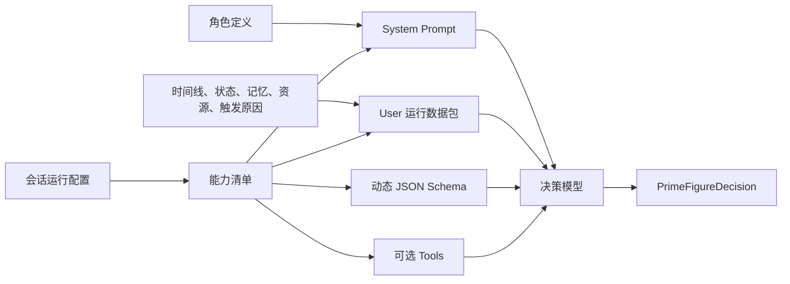
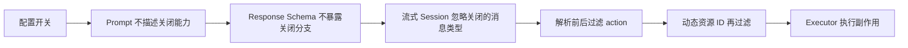
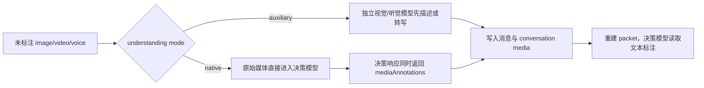
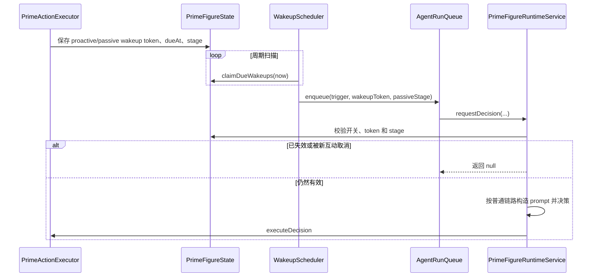

# Prime Figure：可插拔 Prompt、能力模型与运行链路

本文面向需要理解或扩展 `prime-figure` 的开发者，重点回答三个问题：

1. Prime Figure 的 prompt 为什么不是一段固定文本，它如何随角色、配置、上下文和资源动态组装；
2. 图片、语音、表情、转账、回忆、媒体理解、内容优化和唤醒等能力如何被声明、暴露、约束和执行；
3. 一条用户消息如何穿过队列、决策模型、流式交付、媒体服务和持久化层。

> 本文基于当前仓库的 CodeGraph 索引与源码调用关系整理。核心入口是
> [`PrimeFigureRuntimeService.requestDecision`](../apps/server/src/modules/agents/kinds/prime-figure/prime-figure-runtime.service.ts#L111)，
> prompt 入口是
> [`buildPrimeSystemPrompt`](../apps/server/src/modules/agents/kinds/prime-figure/prime-prompt-composer.ts#L7)。

## 1. 一句话理解 Prime Figure

Prime Figure 不是“把人设和聊天记录发给模型，再把文本回复存下来”，而是一套**配置驱动的角色决策运行时**：

- 决策模型输出的不是一段回复，而是 `PrimeFigureDecision`；
- 一次决定可以同时更新情绪、变量、记忆、处境、日程和关系，并按顺序执行多个 action；
- 可用能力会同时影响 system prompt、运行数据包、模型工具、响应 JSON Schema、流式处理和最终执行；
- 图片生成、TTS、媒体理解和内容优化可以使用不同的模型或服务；
- 同一个用户的全局配置可以被单会话配置覆盖。

从设计上看，它更接近一个“小型 agent runtime”，而不是一个普通聊天 completion。

## 2. 关键代码地图

| 责任                               | 主要实现                                                                                                                          |
| ---------------------------------- | --------------------------------------------------------------------------------------------------------------------------------- |
| 消息入站与任务入队                 | [`messaging.service.ts`](../apps/server/src/modules/messaging/messaging.service.ts#L132)                                          |
| Redis Stream、同会话锁、dirty 重跑 | [`run-queue.ts`](../apps/server/src/infra/redis/run-queue.ts#L35)                                                                 |
| 运行任务处理、模型活动心跳         | [`prime-run.processor.ts`](../apps/server/src/modules/messaging/prime-run.processor.ts#L8)                                        |
| 决策主编排                         | [`prime-figure-runtime.service.ts`](../apps/server/src/modules/agents/kinds/prime-figure/prime-figure-runtime.service.ts#L94)     |
| system prompt 组装                 | [`prime-prompt-composer.ts`](../apps/server/src/modules/agents/kinds/prime-figure/prime-prompt-composer.ts#L7)                    |
| 能力开关与 action 过滤             | [`prime-output-capabilities.ts`](../apps/server/src/modules/agents/kinds/prime-figure/prime-output-capabilities.ts#L6)            |
| 动态响应 JSON Schema               | [`buildPrimeDecisionResponseFormat`](../apps/server/src/modules/agents/kinds/prime-figure/prime-figure-runtime.service.ts#L1365)  |
| 增量 JSON 字段解析                 | [`prime-decision-stream-parser.ts`](../apps/server/src/modules/agents/kinds/prime-figure/prime-decision-stream-parser.ts#L40)     |
| 流式消息、图片生成、TTS            | [`prime-decision-stream-session.ts`](../apps/server/src/modules/agents/kinds/prime-figure/prime-decision-stream-session.ts#L100)  |
| 图片/语音二次优化                  | [`prime-content-optimizer.ts`](../apps/server/src/modules/agents/kinds/prime-figure/prime-content-optimizer.ts#L23)               |
| 辅助视觉/听觉理解                  | [`prime-media-annotation.service.ts`](../apps/server/src/modules/agents/kinds/prime-figure/prime-media-annotation.service.ts#L29) |
| action 执行与状态落库              | [`prime-action-executor.ts`](../apps/server/src/modules/agents/kinds/prime-figure/prime-action-executor.ts#L33)                   |
| 唤醒扫描与入队                     | [`prime-figure-silence.scheduler.ts`](../apps/server/src/modules/agents/kinds/prime-figure/prime-figure-silence.scheduler.ts#L5)  |
| 能力配置结构                       | [`runtime-config.types.ts`](../apps/server/src/modules/runtime-config/runtime-config.types.ts#L35)                                |
| 决策/action 领域类型               | [`agent.ts`](../packages/shared/src/types/agent.ts#L367)                                                                          |

## 3. Prompt 的真实形态：四件套，而不是一段字符串

一次 Prime Figure 模型请求由四个彼此配合的部分构成：



### 3.1 System Prompt：稳定规则 + 条件能力块 + 角色定义

[`buildPrimeSystemPrompt`](../apps/server/src/modules/agents/kinds/prime-figure/prime-prompt-composer.ts#L7)
用一个有序的 `blocks` 数组组装 system prompt。顺序可概括为：

1. 解释 API `user` 消息只是运行数据包，真实用户只存在于时间线的 `sender=end_user`；
2. 指定角色视角和“维持人格连续性”的总目标；
3. 注入决策、action、消息、状态、记忆和时间规则；
4. 根据能力开关插入图片、语音、表情、转账和回忆规则；
5. 最后注入人设、背景、性格、回复风格、决策风格和变量定义。

它的“可插拔”首先体现在条件 block：

```ts
...(isPrimeOutputEnabled(config, "image")
  ? [IMAGE_MESSAGE_RULES, imageGuidance(config.outputs.image.guidanceLevel)]
  : [])
```

图片、语音、表情和转账能力关闭后，对应的能力专用规则与指导不会进入 prompt；通用 action block 仍会明确声明该能力当前不可用。图片和语音还可以通过 `basic / medium / advanced` 选择不同指导深度。这样既减少无关细节，也避免模型把关闭的能力误判为可用 action。

另一个容易混淆的点是：Prime Figure **不使用** shared 包中的
[`buildFigureSystemPrompt`](../packages/shared/src/prompts/figure-system-prompt.ts#L30)
占位符模板。那套 `{{figure.persona}}` 机制目前服务于 Slice Figure；Prime Figure 使用专属 composer，把固定运行协议与角色字段直接编译成 prompt。两者不是同一条 prompt 链路。

### 3.2 User 运行数据包：把事实与指令和角色规则分开

[`buildPrimeChatMessages`](../apps/server/src/modules/agents/kinds/prime-figure/prime-figure-runtime.service.ts#L757)
最终只构造一条 system 消息和一条 user 消息。user 消息不是自然语言聊天，而是由多个 content part 组成的结构化运行数据包，主要包含：

- 按时间排序的消息对象：时间、发送者、类型、正文或媒体描述；
- 新到消息的 `attentionId`，帮助模型不漏掉合并窗口内的新消息；
- 当前时间、星期、角色处境、行程、日程、情绪及其“年龄”、关系和变量快照；
- 最近最多 20 条记忆；
- 当前可用的参考图和表情 ID；
- 调试指令、触发原因、未处理转账、日程时段、待标注媒体等动态 hints。

这种分层有两个重要效果：

- 角色规则留在 system prompt，运行事实放在 user packet，职责清晰；
- 所有对话文本都作为 JSON 字段值进入数据包，而不是直接拼成新的 prompt 指令，降低历史内容破坏顶层协议的机会。

代码还会统一清洗时间表达：13 位时间戳会转成角色时区的可读分钟，ISO 时间会去掉秒和时区尾部，避免模型在不同时间格式间漂移。参见
[`sanitizePromptText`](../apps/server/src/modules/agents/kinds/prime-figure/prime-prompt-composer.ts#L172)
与
[`sanitizeVisibleText`](../apps/server/src/modules/agents/kinds/prime-figure/prime-figure-runtime.service.ts#L1997)。

### 3.3 JSON Schema：能力清单的机器可执行版本

Prompt 只负责“告诉模型能做什么”，真正限制输出形状的是
[`buildPrimeDecisionResponseFormat`](../apps/server/src/modules/agents/kinds/prime-figure/prime-figure-runtime.service.ts#L1365)。

Schema 会动态编译以下内容：

- 角色定义了变量时，才要求输出 `variables`，且每个变量带类型、范围和 nullable 语义；
- 图片、语音、表情、转账关闭时，对应 action 分支不出现在 schema；
- 没有可用表情时，即使表情总开关开启，也不暴露 sticker 消息分支；
- 只有主动唤醒开启时，才暴露 `schedule_wakeup`；
- 图片参考 ID、表情 ID、待处理转账 ID 都使用本轮实际可用 ID 枚举；
- 原生媒体理解存在待标注媒体时，才要求等量的 `mediaAnnotations`。

所以能力开关不是只改一段提示词，而是在改变模型可生成的协议。

### 3.4 Tools：按上下文临时挂载的回忆能力

当上下文窗口已经省略部分历史，或持久记忆超过当前可见上限时，`recallAvailable` 为真，运行时才会：

- 在 system prompt 中加入 recall 规则；
- 给 completion 挂载 `search_recall` tool；
- 在疑似回忆请求时加入提示，但仍由模型判断是否调用。

若模型调用工具，运行时会搜索历史消息与记忆，把 tool result 加回消息列表，再执行第二次 completion；第二次关闭 tool，并要求至少写入一条记忆，避免“查到了但没有沉淀”。完整分支位于
[`completeWithOptionalRecall`](../apps/server/src/modules/agents/kinds/prime-figure/prime-figure-runtime.service.ts#L530)。

## 4. “可插拔”的准确含义

当前实现是**条件编译式可插拔**，还不是一个通用的 `PromptPlugin[]` 注册框架。

可以把现有逻辑抽象成下面的模型：

```text
能力清单 = resolve(全局/会话配置, 角色资源, 当前上下文)
systemPrompt = compose(基础规则, 能力规则块, 角色定义)
userPacket = assemble(时间线, 状态, 动态资源, hints)
responseSchema = compile(基础字段, 能力 schema 片段, 动态 ID 枚举)
tools = select(上下文相关工具)
```

这里有三类“插槽”：

| 插槽         | 变化来源             | 当前例子                                                                    |
| ------------ | -------------------- | --------------------------------------------------------------------------- |
| 静态角色插槽 | 角色创建/编辑数据    | persona、background、personality、responseStyle、decisionStyle、变量定义    |
| 配置能力插槽 | 全局配置或会话覆盖   | image、voice、sticker、transfer、optimization、understanding、wakeups       |
| 本轮动态插槽 | 当前消息、状态和资源 | recall、pending media、available stickers、pending transfers、trigger hints |

这种设计比“始终给模型全部能力，再在末端忽略结果”更一致，因为同一个能力会沿多层同步开关。不过它也意味着新增能力通常不是新增一个文件并注册即可，而是需要有意识地修改多个协议层。

## 5. 能力设计

### 5.1 配置先解析，再参与整条链路

Prime Figure 配置定义在
[`StoredPrimeFigureRuntimeConfig`](../apps/server/src/modules/runtime-config/runtime-config.types.ts#L35)，
包括：

- `decisionModel`：主决策模型；
- `outputs`：图片、语音、表情、转账；
- `optimization`：图片 prompt、语音 transcript 的二次优化；
- `understanding`：视觉/音频由主模型原生理解，还是辅助模型预理解；
- `context`、打字速度、消息合并窗口；
- 主动/被动唤醒。

[`RuntimeConfigService.resolveConversationConfig`](../apps/server/src/modules/runtime-config/runtime-config.service.ts#L137)
先选择用户全局配置或会话自定义配置，再校验并交给运行时。默认值见
[`runtime-config.defaults.ts`](../apps/server/src/modules/runtime-config/runtime-config.defaults.ts#L25)：当前默认开启图片和语音，关闭表情、转账、优化及两类唤醒，媒体理解默认走主模型原生模式。

### 5.2 能力矩阵

| 能力     | 开启条件                    | Prompt / 数据包                 | Schema / Tool                  | 运行时实现                             |
| -------- | --------------------------- | ------------------------------- | ------------------------------ | -------------------------------------- |
| 文本     | 始终可用                    | 固定消息规则                    | 固定 text 分支                 | 流式文本增量 + 消息落库                |
| 图片     | `outputs.image.enabled`     | 图片规则 + guidance；参考图列表 | image 分支与动态参考图 ID 枚举 | 流式收齐 prompt/refs 后启动图片生成    |
| 语音     | `outputs.voice.enabled`     | 语音 guidance                   | voice 分支                     | 可流式 TTS；可先优化 transcript        |
| 表情     | 开关开启且有可用表情        | 表情选择规则与列表              | sticker 分支 + sticker ID 枚举 | 复用已有资源，不生成新媒体             |
| 转账     | `outputs.transfer.enabled`  | 转账规则、待处理转账 hint       | send/accept/reject 分支        | 创建转账消息或原子地处理 pending 转账  |
| silence  | 始终可用                    | 固定 action 规则                | 固定分支                       | 本轮不发消息                           |
| mute     | 始终可用                    | 固定 action 规则                | 固定分支                       | 更新屏蔽截止时间；到期后可再次触发决策 |
| 主动唤醒 | `wakeups.proactive.enabled` | 动态 action 说明                | `schedule_wakeup` 分支         | 保存 token/dueAt，由 scheduler 再入队  |
| 被动唤醒 | `wakeups.passive.enabled`   | 唤醒触发 hint                   | 不由模型创建 action            | scheduler 按三个静默里程碑触发         |
| 回忆搜索 | 历史被截断或记忆超过 20 条  | recall 规则与可选 hint          | `search_recall` tool           | 搜索历史/记忆后进行第二次决策          |
| 角色变量 | 角色存在变量定义            | 定义 + 当前快照                 | 动态变量属性与约束             | 按定义归一化并替换状态快照             |
| 媒体理解 | `native` 或 `auxiliary`     | 原始媒体或预先生成的描述/转写   | native 模式要求 annotations    | 标注持久化后可在后续轮次复用           |
| 内容优化 | 对应 optimization 开启      | 独立优化 system prompt          | 单字段严格 schema              | 使用独立模型，失败时回退原始内容       |

### 5.3 能力约束不是单点防线

当前能力安全链按下面的顺序工作：



具体来说：

1. [`isPrimeOutputEnabled`](../apps/server/src/modules/agents/kinds/prime-figure/prime-output-capabilities.ts#L6) 是共享开关判定；
2. prompt composer 和 response schema 都使用相同判定；
3. [`PrimeDecisionStreamSession.handleField`](../apps/server/src/modules/agents/kinds/prime-figure/prime-decision-stream-session.ts#L135) 在增量阶段忽略关闭的图片、语音和表情；
4. [`parsePrimeDecisionEnvelope`](../apps/server/src/modules/agents/kinds/prime-figure/prime-figure-runtime.service.ts#L1813) 在 Zod 解析前后各过滤一次关闭能力；
5. 动态过滤还会删除不存在的表情 ID、不可处理的转账 ID和不可用参考图 ID；
6. executor 对转账和表情还有显式开关检查，然后才产生副作用。

需要注意：executor 并不是所有能力的独立总防火墙。图片和语音主要依赖“动态 schema + 解析过滤 + stream session”保证合法性。因此，若未来出现绕过标准运行时、直接调用 executor 的新入口，应先补齐 executor 侧的统一能力校验。

### 5.4 决策对象把“说什么”和“角色如何变化”统一起来

[`PrimeFigureDecision`](../packages/shared/src/types/agent.ts#L420) 包含：

- `rationale`：本轮决策依据；
- `figureMood`：新的情绪快照；
- `variables`：创作者变量的完整替换快照；
- `memoryWrites`：值得持久化的新记忆；
- `stateUpdates`：处境、日程、行程、关系的可选完整替换；
- `actions`：按顺序执行的消息、转账、沉默、mute 和唤醒动作。

这让“回复”只是 action 的一种，而不是模型输出的唯一目标。

## 6. 完整运行链路

### 6.1 总流程

```mermaid
flowchart TD
    U["用户文本/图片/语音/表情/转账"] --> SAVE["保存消息并记录 interaction sequence"]
    H["调试 hint"] --> Q
    W["主动/被动唤醒或 mute 到期"] --> SCH["Wakeup Scheduler claim due"]
    SCH --> Q["Redis Stream: AgentRunQueue"]
    SAVE --> Q

    Q --> LOCK{"取得 conversation lock?"}
    LOCK -- "否：普通消息" --> DIRTY["设置 dirty，等待当前 run 完成"]
    LOCK -- "否：唤醒/调试" --> REQUEUE["短暂等待后重新入队"]
    LOCK -- "是" --> PROC["PrimeRunProcessor\n活动心跳"]

    PROC --> REQ["requestDecision"]
    REQ --> GUARD{"角色/状态/触发 token/开关/mute 合法?"}
    GUARD -- 否 --> STOP["忽略或记录终止失败"]
    GUARD -- 是 --> QUIET["等待 end_user 安静窗口\n合并短时间连续消息"]
    QUIET --> CTX["加载稳定上下文窗口\n未处理消息 + pending 转账"]
    CTX --> WORK{"存在未处理输入\n或允许无消息触发?"}
    WORK -- 否 --> STOP
    WORK -- 是 --> PACKET["组装 system prompt、user packet、schema 和 tools"]

    PACKET --> AUX{"有 auxiliary 模式未标注媒体?"}
    AUX -- 是 --> ANNO["辅助视觉/听觉模型标注"]
    ANNO --> PERSIST_ANNO["持久化标注"]
    PERSIST_ANNO --> REBUILD["重新构造数据包"]
    REBUILD --> MODEL
    AUX -- 否 --> MODEL["流式调用决策模型"]

    MODEL --> STREAM["增量 JSON parser → StreamSession"]
    STREAM --> RECALL{"模型调用 search_recall?"}
    RECALL -- 是 --> TOOL["搜索历史消息和记忆"]
    TOOL --> MODEL2["第二次 completion\ntoolChoice=none"]
    MODEL2 --> STREAM2["继续增量进入同一 StreamSession"]
    STREAM2 --> PARSE
    RECALL -- 否 --> PARSE["解析 envelope"]

    PARSE --> FILTER["Zod 校验 + 能力过滤 + 动态 ID 过滤"]
    FILTER --> OPT["可选图片/语音二次优化"]
    OPT --> FINALIZE["StreamSession finalize\n等待图片/TTS并保持消息顺序"]
    FINALIZE --> EXEC["PrimeActionExecutor.executeDecision"]

    EXEC --> MSG["消息/转账落库与实时推送"]
    EXEC --> STATE["变量、记忆、情绪、关系、mute、wakeup 状态更新"]
    EXEC --> LOG["action 日志与失败信息"]
    MSG --> ADV["推进 last handled end_user sequence"]
    STATE --> ADV
    LOG --> ADV

    ADV --> CHECK{"dirty 标记存在?"}
    DIRTY -.->|当前 run 完成后检查| CHECK
    REQUEUE --> Q
    CHECK -- 是 --> COALESCE["trigger=coalesced_messages 再运行"]
    COALESCE --> PROC
    CHECK -- 否 --> DONE["释放 lock，结束"]
```



### 6.2 阶段一：消息入站与同会话串行

用户消息先落库、更新会话预览并推送给客户端，然后以 `kind=prime-figure` 入 Redis Stream。参见
[`MessagingService.createUserTextMessage`](../apps/server/src/modules/messaging/messaging.service.ts#L132)
和
[`createUserMediaMessage`](../apps/server/src/modules/messaging/messaging.service.ts#L214)。

[`AgentRunQueue`](../apps/server/src/infra/redis/run-queue.ts#L35) 对每个 conversation 使用 Redis 锁：

- 不同会话可以并发；
- 同一会话一次只运行一个决策；
- 当前运行期间又到普通消息时，不再并发启动第二个决策，而是设置 dirty；
- 当前 run 完成后，若 dirty 存在，就以 `coalesced_messages` 触发原因原地再跑一轮；
- 唤醒和调试任务不折叠为 dirty，而是重新入队，保留其 token 或指令语义。

这保证了角色状态、消息顺序和 last-handled sequence 不会被同会话并发写乱。

### 6.3 阶段二：运行准入与上下文窗口

`requestDecision` 先加载角色、运行状态和最终会话配置，然后执行准入检查：

- conversation 必须绑定 `prime-figure`；
- 主动/被动唤醒必须已开启，且 token、stage 与状态一致；
- 普通消息在 mute 有效期内不触发模型；
- 非调试触发会先等待 `messageCoalesceMs` 的用户安静窗口。

随后 [`loadDecisionContext`](../apps/server/src/modules/agents/kinds/prime-figure/prime-figure-runtime.service.ts#L457) 同时加载：

- 配置范围内的稳定上下文窗口；
- last-handled sequence 之后的全部用户消息；
- 尚未处理的用户转账。

即使上下文窗口淘汰了旧消息，未处理的新消息也会通过
[`mergePrimeTimeline`](../apps/server/src/modules/agents/kinds/prime-figure/prime-figure-runtime.service.ts#L1292)
合并回来，避免消息因窗口边界而丢失。

### 6.4 阶段三：多模态理解

未标注媒体有两种处理方式：



辅助模式可让不支持特定媒体类型的决策模型继续工作；原生模式减少一次额外模型调用。两条路径最后都会把标注持久化，使后续轮次优先复用文本描述，而不是重复上传和理解原始媒体。

### 6.5 阶段四：流式决策与提前执行媒体工作

决策模型返回 JSON，但运行时不会等完整 JSON 到齐才开始所有工作：

1. [`PrimeDecisionStreamParser`](../apps/server/src/modules/agents/kinds/prime-figure/prime-decision-stream-parser.ts#L40) 增量识别 `actions[i].message` 中的 type、text、transcript、generationPrompt 和 referenceMediaIds；
2. [`PrimeDecisionStreamSession`](../apps/server/src/modules/agents/kinds/prime-figure/prime-decision-stream-session.ts#L135) 为每个 action 建立流式状态；
3. 文本 delta 可以实时写缓存并推送；
4. 图片的 generation prompt 与参考 ID 完整后即可提前启动生图；
5. 语音可把 transcript delta 送入流式 TTS；如果语音优化开启，则先等待优化后的 transcript，避免把原稿提前合成；
6. `finalize` 用最终解析后的 decision 补齐增量阶段遗漏的字段，并等待图片/TTS promise，返回 message ID 与媒体结果映射。

当表情或转账开启时，session 会使用 deferred delivery，因为这两类 action 不能像 text/image/voice 一样从 `message` 字段流中完整执行；最终由 executor 统一按 action 顺序发布，防止消息乱序。

### 6.6 阶段五：解析、过滤与二次优化

完整响应进入 [`parsePrimeDecisionEnvelope`](../apps/server/src/modules/agents/kinds/prime-figure/prime-figure-runtime.service.ts#L1813) 后依次经历：

1. JSON parse；
2. 对原始 action 做能力过滤与动态资源过滤；
3. 使用共享 Zod schema 归一化、补默认值和校验；
4. 再做一次能力与动态资源过滤；
5. 移除不可用的图片参考 ID；
6. 归一化本轮媒体标注。

图片或语音 optimization 开启时，
[`PrimeContentOptimizer.optimizeDecision`](../apps/server/src/modules/agents/kinds/prime-figure/prime-content-optimizer.ts#L26)
会并行处理对应 action：

- 图片只重写 `generationPrompt`，保留对话用的 `description`；
- 语音只重写 `transcript`；
- 优化模型使用单字段严格 schema；
- 单个优化失败会记录日志并回退决策模型原稿，不让整轮失败。

### 6.7 阶段六：执行、副作用和状态提交

[`PrimeActionExecutor.executeDecision`](../apps/server/src/modules/agents/kinds/prime-figure/prime-action-executor.ts#L43) 负责把纯决策变成副作用：

- 按 action 顺序创建文本、图片、语音、表情和转账消息；
- 处理用户 pending 转账的接受或拒绝；
- 更新会话预览、未读数和实时事件；
- 应用变量快照、追加记忆、更新情绪及其观察时间；
- 应用处境、日程、行程和关系更新；
- 设置/解除 mute，创建/取消主动唤醒，推进被动唤醒阶段；
- 保存角色运行状态和每个 action 的审计日志。

所有 action 执行成功后，运行时才推进 conversation 的 `last handled end-user sequence`。这样一轮如果在执行前失败，新用户消息仍会被视为未处理，可由队列重试。

## 7. 唤醒链路

唤醒不是绕过正常运行时的一条特殊回复通道，而只是另一种决策触发源：



主动唤醒由模型通过 `schedule_wakeup` 创建；被动唤醒由配置的三个静默里程碑驱动。新互动、发送消息、关闭能力等操作会使相应 wakeup 失效或被清理，token 校验用于拦截已经排队但过期的任务。

## 8. 失败与降级

Prime Figure 把“整轮失败”和“局部能力失败”区分处理：

- 决策模型、解析或主编排失败：`StreamSession.fail` 会把已创建的流式消息标为失败并附带诊断；runtime 记录终止失败并返回 `null`；
- 图片/语音优化失败：记录单 action 失败，回退原稿继续；
- 图片生成失败：保留错误映射，最终消息可以失败或带生成失败 metadata；
- TTS 失败：文本 transcript 仍可保留，并向客户端发送音频失败事件；
- 队列任务异常：最多重入队 3 次，之后进入 failed stream；
- 唤醒 token 失效：静默丢弃，不把过期任务当系统错误。

这种边界让可选媒体服务不至于轻易拖垮角色的核心文字决策与状态推进。

## 9. 扩展一种新能力时应修改什么

以新增一种 `location` action 为例，至少要沿同一条能力链检查以下位置：

1. **领域类型与校验**：扩展 `PrimeFigureAction` 和共享 Zod schema；
2. **配置清单**：若能力可开关，加入 stored/view/patch/default/normalize/validate/redact 全链路；
3. **Prompt block**：说明语义、选择条件和禁止事项；
4. **动态 response schema**：只在能力可用时加入 action 分支，并把本轮资源约束编译为枚举；
5. **流式策略**：决定该 action 能否增量展示，若不能，确保 deferred delivery 保序；
6. **解析过滤**：在模型或 provider 不严格遵守 schema 时删除越权/无效 action；
7. **Executor**：再次校验能力和资源所有权，再执行副作用；
8. **状态与审计**：明确幂等键、失败状态、action log 和 last-handled sequence 的提交顺序；
9. **前端协议**：补齐消息渲染、实时事件和配置 UI；
10. **测试**：至少覆盖“开启、关闭、动态资源为空、流式中途失败、重试/重复执行”五类场景。

理想情况下，可以进一步把这些分散规则收敛为显式的 capability descriptor：

```ts
interface PrimeCapability {
  id: string;
  enabled(context: CapabilityContext): boolean;
  promptBlocks(context: CapabilityContext): string[];
  responseSchema(context: CapabilityContext): object[];
  filter?(action: unknown, context: CapabilityContext): boolean;
  execute?(action: unknown, context: ExecutionContext): Promise<void>;
}
```

这不是当前已有接口，而是对现有条件分支的自然演进方向。若实施，应保留当前“同一份能力事实同时驱动 prompt、schema、过滤与执行”的核心原则，避免各层各自判断后产生漂移。

## 10. 设计总结

Prime Figure 的核心不是某一句 prompt，而是一个**能力感知的协议编译与执行过程**：

```text
角色定义 + 会话状态 + 运行配置 + 本轮资源
        ↓
System Prompt + User Packet + JSON Schema + Tools
        ↓
结构化 Decision
        ↓
能力过滤 + 动态资源校验 + 可选优化
        ↓
流式消息/媒体交付 + 状态迁移 + 审计日志
```

它当前已经实现了较完整的多层能力约束和运行编排；“可插拔”主要由配置驱动的条件 prompt block、动态 schema 和运行时分支实现。理解这一点后，排查问题时就不应只看 prompt 文本，而要同时检查本轮配置、数据包、schema、解析过滤、stream session 和 executor 六个位置。
