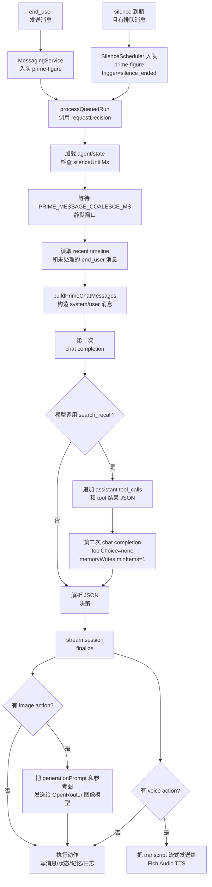
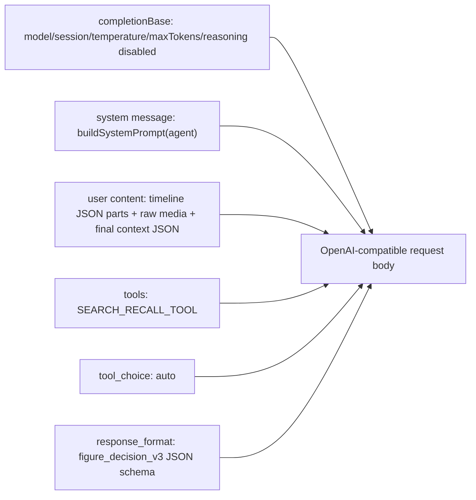

# prime-figure 运行时与提示词注入点

本文档只描述当前代码中的 `prime-figure` 运行时。重点是：一次运行会如何构造 LLM/API 请求，以及每个请求中模型可见的提示词、工具描述、JSON schema 描述、媒体和动态 hint 从哪里进入。

## 总览流程



入口位置：

- 用户文本消息写入后，`prime-figure` 会入队，不会同步生成回复：[`messaging.service.ts`](../apps/server/src/modules/messaging/messaging.service.ts#L100-L106)。
- worker 消费队列后调用 `PrimeFigureRuntimeService.requestDecision`：[`messaging.service.ts`](../apps/server/src/modules/messaging/messaging.service.ts#L126-L130)。
- silence 到期时，如果沉默期间有排队消息，scheduler 会以 `trigger: "silence_ended"` 入队：[`prime-figure-silence.scheduler.ts`](../apps/server/src/modules/agents/kinds/prime-figure/prime-figure-silence.scheduler.ts#L37-L52)。
- `requestDecision` 会加载 agent/state、跳过未到期 silence，并等待用户静默窗口：[`prime-figure-runtime.service.ts`](../apps/server/src/modules/agents/kinds/prime-figure/prime-figure-runtime.service.ts#L70-L127)。

## 决策请求的构造

运行时先读取最近上下文和未处理的新用户消息，并调用 `buildPrimeChatMessages` 产出 chat messages：[`prime-figure-runtime.service.ts`](../apps/server/src/modules/agents/kinds/prime-figure/prime-figure-runtime.service.ts#L136-L192)。

第一次 LLM 请求的可见内容如下：



代码中第一次请求会传入 `messages`、`tools: [SEARCH_RECALL_TOOL]`、`toolChoice: "auto"`、`responseFormat`：[`prime-figure-runtime.service.ts`](../apps/server/src/modules/agents/kinds/prime-figure/prime-figure-runtime.service.ts#L198-L223)。这些字段最终会被放进 OpenAI-compatible `/chat/completions` body：[`openai-compatible-chat.ts`](../apps/server/src/modules/ai/providers/openai-compatible-chat.ts#L184-L201)。

### system message

`system` 内容由 `buildSystemPrompt(agent)` 注入：[`prime-figure-runtime.service.ts`](../apps/server/src/modules/agents/kinds/prime-figure/prime-figure-runtime.service.ts#L837-L878)。

它包含三类信息：

- 固定运行规则：角色视角、不是取悦用户、先输出简洁 rationale、禁止输出隐藏思维链或 `userIntent` 等、消息数量建议、`send_message` 与 `silence` 互斥、时间格式、何时使用 `search_recall`、必须返回严格 JSON 等。
- 图片和语音规则：图片 action 必须提供 `description` 与 `generationPrompt`，语音 action 的 `transcript` 会用于 TTS；图片参考图只能来自 user 数据包中的 `availableReferenceImages`；语音可使用 Fish Audio 表演标签。
- 创作者/角色配置：`persona`、`background`、`personality`、`responseStyle`、`decisionStyle`、`currentSituation`、`itinerary`、每周 `schedule`、自定义输出参数定义。

图片 `generationPrompt` 的四段格式规范也直接拼进 system prompt：[`prime-figure-runtime.service.ts`](../apps/server/src/modules/agents/kinds/prime-figure/prime-figure-runtime.service.ts#L880-L887)。因此，决策 LLM 会看到“正向提示词/负向提示词/机位与身体逻辑检查/推荐比例”的要求。

### user message

`user` 是一个 content parts 数组，由对话时间线和最终上下文组成：[`prime-figure-runtime.service.ts`](../apps/server/src/modules/agents/kinds/prime-figure/prime-figure-runtime.service.ts#L456-L759)。

时间线部分：

- 文本消息会作为 JSON 文本 part 注入，字段包括 `at`、`sender`、可选 `attentionId`、`type: "text"`、`text`：[`prime-figure-runtime.service.ts`](../apps/server/src/modules/agents/kinds/prime-figure/prime-figure-runtime.service.ts#L552-L563)。
- 已有描述的图片/视频会作为 JSON 文本 part 注入 `description`；没有描述的图片/视频会注入 `annotationId` 和 `description: null`，并额外追加原始 `image_url` 或 `video_url` data URL part：[`prime-figure-runtime.service.ts`](../apps/server/src/modules/agents/kinds/prime-figure/prime-figure-runtime.service.ts#L566-L623)、[`prime-figure-runtime.service.ts`](../apps/server/src/modules/agents/kinds/prime-figure/prime-figure-runtime.service.ts#L790-L824)。
- 已有转写的语音会作为 JSON 文本 part 注入 `transcript`；没有转写的语音会注入 `annotationId` 和 `transcript: null`，并额外追加 `input_audio` part：[`prime-figure-runtime.service.ts`](../apps/server/src/modules/agents/kinds/prime-figure/prime-figure-runtime.service.ts#L626-L681)、[`prime-figure-runtime.service.ts`](../apps/server/src/modules/agents/kinds/prime-figure/prime-figure-runtime.service.ts#L826-L834)。
- sticker 和 transfer 也会被转成 JSON 文本 part：[`prime-figure-runtime.service.ts`](../apps/server/src/modules/agents/kinds/prime-figure/prime-figure-runtime.service.ts#L684-L715)。

最后一个 user JSON part 注入运行时上下文：`now`、`weekday`、`figureNow.mood`、`figureNow.relationship`、`figureNow.variables`、可见 `memories`、`availableReferenceImages`、`hints`：[`prime-figure-runtime.service.ts`](../apps/server/src/modules/agents/kinds/prime-figure/prime-figure-runtime.service.ts#L731-L747)。

### hints 注入规则

`hints` 是 user message 最后一个 JSON part 中的数组，不是 system prompt。当前有这些来源：

- 新出现且必须注意的 end_user 消息会被分配 `attention_1`、`attention_2` 等，并写入 hint：[`prime-figure-runtime.service.ts`](../apps/server/src/modules/agents/kinds/prime-figure/prime-figure-runtime.service.ts#L477-L493)。
- 最近一条用户文本命中回忆关键词正则时，写入“可能需要考虑调用 search_recall”的 hint：[`prime-figure-runtime.service.ts`](../apps/server/src/modules/agents/kinds/prime-figure/prime-figure-runtime.service.ts#L495-L502)。
- 根据最近用户消息时间匹配角色日程，写入当前日程时段；匹配不到则写入“不处于任何日程时段”：[`prime-figure-runtime.service.ts`](../apps/server/src/modules/agents/kinds/prime-figure/prime-figure-runtime.service.ts#L503-L509)。
- `trigger === "silence_ended"` 时写入沉默期结束提示；`trigger === "coalesced_messages"` 时写入上一轮决定期间收到新消息的提示：[`prime-figure-runtime.service.ts`](../apps/server/src/modules/agents/kinds/prime-figure/prime-figure-runtime.service.ts#L510-L518)。
- 如果本轮有未标注媒体，写入必须在 `mediaAnnotations` 中补描述或转写的 hint：[`prime-figure-runtime.service.ts`](../apps/server/src/modules/agents/kinds/prime-figure/prime-figure-runtime.service.ts#L718-L721)。

### tool 描述

第一次请求会暴露 `search_recall` function tool：[`prime-figure-runtime.service.ts`](../apps/server/src/modules/agents/kinds/prime-figure/prime-figure-runtime.service.ts#L889-L919)。

模型可见内容包括：

- tool name: `search_recall`
- tool description：只能在 end_user 明确询问角色是否记得过去事实/事件、且可见记忆与近期上下文不足时调用；普通问题、仅出现“记得”等词、上下文已足够时不得调用；调用后最终 `memoryWrites` 必须至少一条。
- parameters schema：`keywords` 是 1 到 6 个简短关键词；`limit` 是 1 到 8 的整数；`additionalProperties: false`。

如果模型调用工具，运行时会用关键词搜索更早消息和 state memories，并返回一个 tool message，内容是 JSON 字符串：

```json
{
  "history": [["YYYY-MM-DDTHH:mm", "figure/end_user", "可见文本"]],
  "memories": [["YYYY-MM-DDTHH:mm", "记忆内容"]]
}
```

工具结果构造位置：[`prime-figure-runtime.service.ts`](../apps/server/src/modules/agents/kinds/prime-figure/prime-figure-runtime.service.ts#L366-L399)。

## JSON output schema 注入

`response_format` 是 strict JSON schema，名称为 `figure_decision_v3`：[`prime-figure-runtime.service.ts`](../apps/server/src/modules/agents/kinds/prime-figure/prime-figure-runtime.service.ts#L921-L1072)。

模型可见的 schema 说明包括：

- 顶层 description：这是“针对当前运行时事件数据包的一次以角色为中心的决定”。
- `rationale`：要求简洁分析角色自己的情绪、动机、日程、记忆、欲望、抗拒和边界，而不是用户意图。
- `figureMood`：本次决定时的当前情绪。
- `variables`：来自创作者定义的每个输出参数；每个变量 schema 会拼入变量描述，并说明 `null` 保留先前值：[`prime-figure-runtime.service.ts`](../apps/server/src/modules/agents/kinds/prime-figure/prime-figure-runtime.service.ts#L1275-L1295)。
- `memoryWrites`：新增持久记忆；第一次请求 `minItems: 0`，如果走过 `search_recall`，第二次请求 `minItems: 1`。
- `stateUpdates`：可选持久上下文替换，包含 `currentSituation`、`schedule`、`itinerary`、`relationshipStatus`。
- `actions`：要么是一条或多条 `send_message`，要么是单独一个 `silence`。
- 有待标注媒体时，额外要求 `mediaAnnotations`，数量必须等于待标注媒体数：[`prime-figure-runtime.service.ts`](../apps/server/src/modules/agents/kinds/prime-figure/prime-figure-runtime.service.ts#L1046-L1058)。

`send_message` 的 schema 会继续告诉模型：

- 文本消息要输出 `text`。
- 图片消息要输出 `description`、`generationPrompt`、`referenceMediaIds`；`generationPrompt` 的 schema description 明确说它会“供实际图像生成服务直接使用”：[`prime-figure-runtime.service.ts`](../apps/server/src/modules/agents/kinds/prime-figure/prime-figure-runtime.service.ts#L1193-L1229)。
- 语音消息要输出 `transcript`，并说明它是实际说出的内容和 TTS 输入：[`prime-figure-runtime.service.ts`](../apps/server/src/modules/agents/kinds/prime-figure/prime-figure-runtime.service.ts#L1230-L1244)。
- `silence` 要输出 `revisitAfterMinutes`：[`prime-figure-runtime.service.ts`](../apps/server/src/modules/agents/kinds/prime-figure/prime-figure-runtime.service.ts#L1253-L1272)。

## 可选的第二次 LLM 请求

如果第一次响应包含 `search_recall` tool call，运行时会原地追加两条消息后再次调用 LLM：[`prime-figure-runtime.service.ts`](../apps/server/src/modules/agents/kinds/prime-figure/prime-figure-runtime.service.ts#L226-L256)。

第二次请求中模型可见内容：

- 原本的 system message。
- 原本的 user content parts。
- 追加的 assistant message：`content` 是第一次模型输出文本，`tool_calls` 是第一次模型发出的 tool call。
- 追加的 tool message：`name: "search_recall"`，`tool_call_id` 对应 tool call id，`content` 是工具返回的 `history/memories` JSON。
- 新的 `response_format`：同一个 `figure_decision_v3` schema，但 `memoryWrites.minItems` 变为 `1`。
- `toolChoice: "none"`，且这次 completion 没有再传 `tools`。

这意味着：一轮 prime decision 最多会让决策 LLM 看到两次请求；第二次只在 recall tool 被调用后出现。

## 图片生成请求

当 LLM 输出 image action，stream session 在收到完整 `generationPrompt` 和 `referenceMediaIds` 后会启动图片生成：[`prime-decision-stream-session.ts`](../apps/server/src/modules/agents/kinds/prime-figure/prime-decision-stream-session.ts#L347-L397)。

图像模型可见内容来自 `OpenRouterImageGenerationService.generate`：[`openrouter-image-generation.service.ts`](../apps/server/src/modules/image-generation/openrouter-image-generation.service.ts#L27-L71)。

请求 body 中只有一个 `user` message：

- 第一个 content part 是 `{ type: "text", text: input.prompt }`，也就是决策 LLM 产出的 `generationPrompt`。
- 后续 content parts 是被 `referenceMediaIds` 解析出来的参考图 data URL。
- 额外参数包括 `modalities: ["image", "text"]`、`image_config.aspect_ratio` 和 `image_size: "1K"`；`aspect_ratio` 会从 `generationPrompt` 的【推荐比例】中提取，提取失败默认为 `3:4`。

因此，图片 action 有两层提示词可见性：

1. 决策 LLM 先在 system prompt 和 schema description 中看到如何写 `generationPrompt`。
2. 图像模型随后直接看到这个 `generationPrompt` 文本和参考图。

## 语音 TTS 请求

语音 action 的 `transcript` 会在流式解析期间写入 Fish Audio WebSocket：[`prime-decision-stream-session.ts`](../apps/server/src/modules/agents/kinds/prime-figure/prime-decision-stream-session.ts#L286-L344)、[`prime-decision-stream-session.ts`](../apps/server/src/modules/agents/kinds/prime-figure/prime-decision-stream-session.ts#L427-L429)。

Fish Audio 请求不是 LLM 决策请求，但外部 TTS 服务会看到：

- start payload 中的空 `text`、`format`、`latency`、`chunk_length`、`reference_id`：[`fish-audio-tts.service.ts`](../apps/server/src/modules/tts/fish-audio-tts.service.ts#L66-L79)。
- 后续 `event: "text"` payload 中的 `text`，也就是模型输出的 `transcript` delta：[`fish-audio-tts.service.ts`](../apps/server/src/modules/tts/fish-audio-tts.service.ts#L95-L104)。

## 执行与持久化

LLM 最终文本会被 `JSON.parse` 和 `primeFigureDecisionSchema.parse` 校验，然后执行动作、写状态、写记忆、写日志：[`prime-figure-runtime.service.ts`](../apps/server/src/modules/agents/kinds/prime-figure/prime-figure-runtime.service.ts#L259-L303)。

如果本轮补充了媒体标注，运行时会把 `mediaAnnotations` 写回消息和 conversation media 索引，之后同一媒体就可以在后续 user message 中以文本描述形式出现：[`prime-figure-runtime.service.ts`](../apps/server/src/modules/agents/kinds/prime-figure/prime-figure-runtime.service.ts#L305-L358)。
