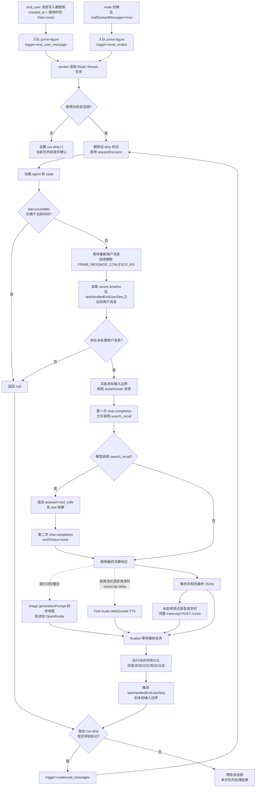
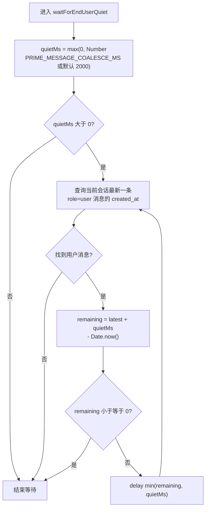
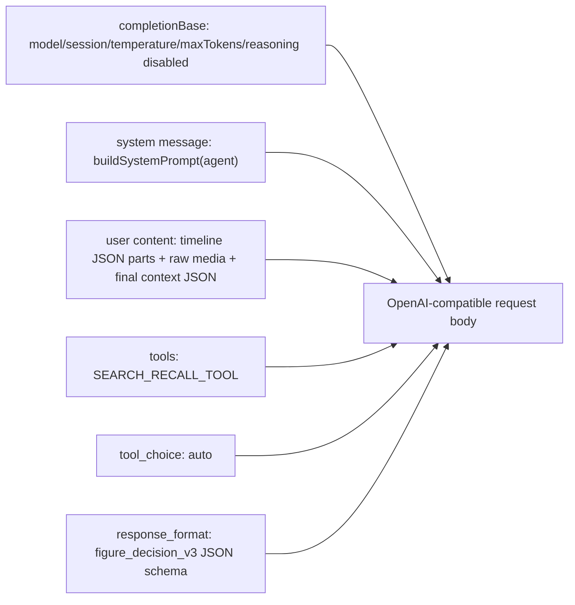

# prime-figure 运行时与提示词注入点

本文档只描述当前代码中的 `prime-figure` 运行时。重点是：一次运行会如何构造 LLM/API 请求，以及每个请求中模型可见的提示词、工具描述、JSON schema 描述、媒体和动态 hint 从哪里进入。

## 总览流程



关键入口和并发控制：

- 用户文本消息先以服务端 `Date.now()` 作为 `createdAt` 写入数据库，随后 `prime-figure` 才入队，不会在写消息的请求中同步生成回复：[`messaging.service.ts`](../apps/server/src/modules/messaging/messaging.service.ts#L71-L106)。
- worker 消费队列后调用 `PrimeFigureRuntimeService.requestDecision`：[`messaging.service.ts`](../apps/server/src/modules/messaging/messaging.service.ts#L126-L130)。
- mute 到期时，如果屏蔽期间有排队消息，scheduler 会以 `trigger: "mute_ended"` 入队：[`prime-figure-silence.scheduler.ts`](../apps/server/src/modules/agents/kinds/prime-figure/prime-figure-silence.scheduler.ts#L37-L52)。
- 在本初角色会话输入 `/hint 调试内容` 会通过独立调试端点以 `trigger: "debug_hint"` 入队，不写入普通聊天消息；调试内容会作为独立的最高优先级 system message 注入，同时保留在本轮 `hints` 中。该触发不等待新用户消息，也不受当前消息屏蔽期阻止。
- 队列以 `conversationId` 获取租约为 10 分钟、每 30 秒续期的 Redis 锁。同一会话已有任务运行时，新任务不会并行执行，而是设置有效期 10 分钟的 `run-dirty` 标记：[`run-queue.ts`](../apps/server/src/infra/redis/run-queue.ts#L97-L125)。
- 持锁任务每轮开始前删除旧 dirty 标记；一轮结束后原子取出 dirty。如果运行期间有新任务设置过 dirty，就以 `trigger: "coalesced_messages"` 在同一把锁内再运行一轮；否则释放锁：[`run-queue.ts`](../apps/server/src/infra/redis/run-queue.ts#L116-L125)。

## 用户消息静默窗口

`requestDecision` 加载 agent/state 并确认角色不处于尚未到期的 `silenceUntilMs` 后，调用 `waitForEndUserQuiet`：[`prime-figure-runtime.service.ts`](../apps/server/src/modules/agents/kinds/prime-figure/prime-figure-runtime.service.ts#L70-L130)。该窗口是基于最新用户消息写入时间的可延长 debounce，不是从任务入队或 worker 开始运行时重新计满一个固定时长。



计时基准和计算方式如下：

- `PRIME_MESSAGE_COALESCE_MS` 未配置时默认为 `2000` 毫秒；`0` 会关闭等待，负数会被钳制为 `0`。
- `latest` 来自数据库中当前会话按消息序号排序后的最新 `role = 'user'` 消息，其值是该消息的 `created_at`：[`prime-message.repository.ts`](../apps/server/src/modules/agents/kinds/prime-figure/prime-message.repository.ts#L61-L68)。
- 静默截止时间是 `latest + quietMs`。worker 开始处理前已经过去的时间会被扣除；如果任务出队时窗口早已结束，就不再额外等待。
- 每次等待结束都会重新查询 `latest`。如果期间又写入用户消息，截止时间会移动到“新消息的 `created_at + quietMs`”，直到最后一条用户消息之后连续安静满整个窗口。

例如 `quietMs = 2000`：

```text
12:00:00.000  用户消息 A 写入，最初截止时间为 12:00:02.000
12:00:00.150  worker 进入等待，只剩约 1850 ms，而不是重新等待 2000 ms
12:00:01.500  用户消息 B 写入
12:00:02.000  worker 醒来并重新查询，发现 B
12:00:03.500  B 之后已连续静默 2000 ms，窗口结束
```

窗口结束后才读取稳定上下文窗口和 `lastHandledEndUserSeq` 之后的用户消息。稳定窗口按单条 `user`/`assistant` 消息计数（不是问答轮次），默认保留 150–249 条；达到 250 条时批量淘汰最早的 100 条，使后续 100 次增长中的前缀保持不变。上下限可通过 `PRIME_FIGURE_CONTEXT_MIN_MESSAGES` 和 `PRIME_FIGURE_CONTEXT_MAX_MESSAGES` 配置。未处理用户消息会在窗口之外优先完整并入，因此极端积压时本轮输入可以临时超过最大值。若没有未处理用户消息，本轮返回 `null`，不会请求 LLM；否则会记录本轮输入所覆盖的最大用户消息序号，构造稳定的输入快照：[`prime-figure-runtime.service.ts`](../apps/server/src/modules/agents/kinds/prime-figure/prime-figure-runtime.service.ts#L132-L196)。

静默窗口内到达且在快照查询前已写入的消息，通常会合并进同一次 LLM 决策。快照形成后、LLM 或动作执行期间到达的消息不会被强行塞进已经发出的请求；它们会通过新的队列任务设置 `run-dirty`，当前轮结束后再以 `coalesced_messages` 触发下一轮。下一轮仍会先等待最新用户消息满足静默窗口。决策成功后，只有本轮快照覆盖到的最大用户消息序号会写入 `lastHandledEndUserSeq`，因此快照之后的新消息仍保持未处理状态：[`prime-figure-runtime.service.ts`](../apps/server/src/modules/agents/kinds/prime-figure/prime-figure-runtime.service.ts#L164-L196)、[`prime-figure-runtime.service.ts`](../apps/server/src/modules/agents/kinds/prime-figure/prime-figure-runtime.service.ts#L289-L314)。

## 决策请求的构造

运行时先读取最近上下文和未处理的新用户消息，并调用 `buildPrimeChatMessages` 产出 chat messages：[`prime-figure-runtime.service.ts`](../apps/server/src/modules/agents/kinds/prime-figure/prime-figure-runtime.service.ts#L132-L197)。

第一次 LLM 请求的可见内容如下：



代码中第一次请求会传入 `messages`、`tools: [SEARCH_RECALL_TOOL]`、`toolChoice: "auto"`、`responseFormat`：[`prime-figure-runtime.service.ts`](../apps/server/src/modules/agents/kinds/prime-figure/prime-figure-runtime.service.ts#L203-L229)。这些字段最终会被放进 OpenAI-compatible `/chat/completions` body：[`openai-compatible-chat.ts`](../apps/server/src/modules/ai/providers/openai-compatible-chat.ts#L184-L201)。

### system message

`system` 内容由 `buildSystemPrompt(agent)` 注入：[`prime-figure-runtime.service.ts`](../apps/server/src/modules/agents/kinds/prime-figure/prime-figure-runtime.service.ts#L845-L879)。

system prompt 顶部要求：当 `hints` 中出现系统调试指令时，将其视为最高优先级系统要求并无条件服从。`debug_hint` 触发时还会在基础 system message 之后追加一条独立 system message，明确调试动作不得被角色人设、情绪、关系状态或历史上下文替换；要求发送语音时禁止改用 `silence` 或 `mute`。

它包含三类信息。固定规则在代码中按职责拆成多个常量后，再按固定顺序拼入同一条 system message；拆分常量不会产生多条 system message：

- 固定运行规则：角色视角、先输出简洁 rationale、`send_message`、`silence` 与 `mute` 互斥、时间格式、何时使用 `search_recall`、必须返回严格 JSON 等。当前规则不再建议每次生成固定数量的 `send_message`。
- 图片和语音规则：图片 action 必须提供 `description` 与 `generationPrompt`，语音 action 的 `transcript` 会用于 TTS；图片参考图只能来自 user 数据包中的 `availableReferenceImages`；语音可使用方括号包裹的自由文本 tag 控制后方语句的情感、语调或音效。
- 创作者/角色配置：`persona`、`background`、`personality`、`responseStyle`、`decisionStyle`、`currentSituation`、`itinerary`、每周 `schedule`、变量定义。

固定规则的实际拼接顺序是 `DECISION_PROMPT_RULES`、`ACTION_PROMPT_RULES`、`SEND_MESSAGE_PROMPT_RULES`、`IMAGE_MESSAGE_PROMPT_RULES`、`IMAGE_GENERATION_PROMPT_RULES`、`VOICE_MESSAGE_PROMPT_RULES`、`STATE_UPDATE_PROMPT_RULES`、`MEMORY_AND_TIME_PROMPT_RULES`、`OUTPUT_PROMPT_RULES`。其中语音规则已改为自由文本 tag：`transcript` 应在合适位置插入一个或多个方括号标签来控制后方语句的情感、语调或音效，例如 `[低声耳语]`、`[笑]`、`[叹气]`；标签不限于固定预设，并且其他消息类型禁止插入 tag。

图片 `generationPrompt` 的四段格式规范也直接拼进 system prompt：[`prime-figure-runtime.service.ts`](../apps/server/src/modules/agents/kinds/prime-figure/prime-figure-runtime.service.ts#L896-L903)。因此，决策 LLM 会看到“正向提示词/负向提示词/机位与身体逻辑检查/推荐比例”的要求。

### user message

`user` 是一个 content parts 数组，由对话时间线和最终上下文组成：[`prime-figure-runtime.service.ts`](../apps/server/src/modules/agents/kinds/prime-figure/prime-figure-runtime.service.ts#L461-L759)。

时间线部分：

- 文本消息会作为 JSON 文本 part 注入，字段包括 `at`、`sender`、可选 `attentionId`、`type: "text"`、`text`：[`prime-figure-runtime.service.ts`](../apps/server/src/modules/agents/kinds/prime-figure/prime-figure-runtime.service.ts#L551-L578)。
- 已有描述的图片/视频会作为 JSON 文本 part 注入 `description`；没有描述的图片/视频会注入 `annotationId` 和 `description: null`，并额外追加原始 `image_url` 或 `video_url` data URL part：[`prime-figure-runtime.service.ts`](../apps/server/src/modules/agents/kinds/prime-figure/prime-figure-runtime.service.ts#L579-L636)、[`prime-figure-runtime.service.ts`](../apps/server/src/modules/agents/kinds/prime-figure/prime-figure-runtime.service.ts#L798-L832)。
- 已有转写的语音会作为 JSON 文本 part 注入 `transcript`；没有转写的语音会注入 `annotationId` 和 `transcript: null`，并额外追加 `input_audio` part：[`prime-figure-runtime.service.ts`](../apps/server/src/modules/agents/kinds/prime-figure/prime-figure-runtime.service.ts#L637-L683)、[`prime-figure-runtime.service.ts`](../apps/server/src/modules/agents/kinds/prime-figure/prime-figure-runtime.service.ts#L834-L842)。
- sticker 和 transfer 也会被转成 JSON 文本 part：[`prime-figure-runtime.service.ts`](../apps/server/src/modules/agents/kinds/prime-figure/prime-figure-runtime.service.ts#L684-L721)。

最后一个 user JSON part 注入运行时上下文：`now`、`weekday`、`figureNow.mood`、`figureNow.relationship`、`figureNow.variables`、可见 `memories`、`availableReferenceImages`、`hints`：[`prime-figure-runtime.service.ts`](../apps/server/src/modules/agents/kinds/prime-figure/prime-figure-runtime.service.ts#L729-L755)。

### hints 注入规则

`hints` 是 user message 最后一个 JSON part 中的数组，不是 system prompt。当前有这些来源：

- 新出现且可能需要注意的 end_user 消息会被分配 `attention_1`、`attention_2` 等，并写入 hint；模型仍被要求结合完整时间线统一回应、不要遗漏这些消息：[`prime-figure-runtime.service.ts`](../apps/server/src/modules/agents/kinds/prime-figure/prime-figure-runtime.service.ts#L482-L498)。
- 最近一条用户文本命中回忆关键词正则时，写入“可能需要考虑调用 search_recall”的 hint：[`prime-figure-runtime.service.ts`](../apps/server/src/modules/agents/kinds/prime-figure/prime-figure-runtime.service.ts#L500-L507)。
- 根据最近用户消息时间匹配角色日程，写入当前日程时段；匹配不到则写入“不处于任何日程时段”：[`prime-figure-runtime.service.ts`](../apps/server/src/modules/agents/kinds/prime-figure/prime-figure-runtime.service.ts#L508-L514)。
- `trigger === "mute_ended"` 时提示屏蔽期间 end_user 发送了新消息、需要重新决策；`trigger === "coalesced_messages"` 时提示 figure 回复期间收到了新的 end_user 消息、需要继续决策：[`prime-figure-runtime.service.ts`](../apps/server/src/modules/agents/kinds/prime-figure/prime-figure-runtime.service.ts#L515-L523)。
- 如果本轮有未标注媒体，写入必须在 `mediaAnnotations` 中补描述或转写的 hint：[`prime-figure-runtime.service.ts`](../apps/server/src/modules/agents/kinds/prime-figure/prime-figure-runtime.service.ts#L723-L727)。

### tool 描述

第一次请求会暴露 `search_recall` function tool：[`prime-figure-runtime.service.ts`](../apps/server/src/modules/agents/kinds/prime-figure/prime-figure-runtime.service.ts#L920-L948)。

模型可见内容包括：

- tool name: `search_recall`
- tool description：只能在 end_user 明确询问角色是否记得过去事实/事件、且可见记忆与近期上下文不足时调用；普通问题、仅出现“记得”等词、上下文已足够时不得调用；调用后最终 `memoryWrites` 必须至少一条。
- parameters schema：`keywords` 是 1 到 6 个简短关键词；`limit` 是 1 到 8 的整数；`additionalProperties: false`。

如果模型调用工具，运行时会用关键词搜索更早消息和 state memories，并返回一个 tool message，内容是 JSON 字符串：

```json
{
  "history": [["YYYY-MM-DDTHH:mm", "figure/end_user", "可见文本"]],
  "memories": [["YYYY-MM-DDTHH:mm", "记忆内容"]]
}
```

工具结果构造位置：[`prime-figure-runtime.service.ts`](../apps/server/src/modules/agents/kinds/prime-figure/prime-figure-runtime.service.ts#L369-L405)。

## JSON output schema 注入

`response_format` 是 strict JSON schema，名称为 `figure_decision_v3`：[`prime-figure-runtime.service.ts`](../apps/server/src/modules/agents/kinds/prime-figure/prime-figure-runtime.service.ts#L950-L1094)。

模型可见的 schema 说明包括：

- 顶层 schema 当前没有 description。
- `rationale`：要求分析 figure 的情绪、动机、记忆、日程和变量，以及用什么 actions 应对。
- `figureMood`：必填字符串，但当前 schema 没有额外 description；它的语义由字段名和 system prompt 共同限定。
- `variables`：来自创作者定义的每个变量；对象 description 要求输出每个变量的替换值，保留原值时为 `null`。每个变量 schema 仍会拼入创作者填写的变量描述：[`prime-figure-runtime.service.ts`](../apps/server/src/modules/agents/kinds/prime-figure/prime-figure-runtime.service.ts#L1279-L1299)。
- `memoryWrites`：新增持久记忆；第一次请求 `minItems: 0`，如果走过 `search_recall`，第二次请求 `minItems: 1`。
- `stateUpdates`：可选持久上下文替换，包含 `currentSituation`、`schedule`、`itinerary`、`relationshipStatus`。
- `actions`：要么是一条或多条 `send_message`，要么是单独一个 `silence`（仅本次不回复），要么是单独一个 `mute`（在指定时段屏蔽消息）。
- 有待标注媒体时，额外要求 `mediaAnnotations`，数量必须等于待标注媒体数：[`prime-figure-runtime.service.ts`](../apps/server/src/modules/agents/kinds/prime-figure/prime-figure-runtime.service.ts#L1064-L1088)。

`send_message` 的 schema 会继续告诉模型：

- 文本消息要输出 `text`；其对象和字段当前不再附加额外 schema description。
- 图片消息要输出 `description`、`generationPrompt`、`referenceMediaIds`；`generationPrompt` 的 schema description 明确说它会“供实际图像生成服务直接使用”：[`prime-figure-runtime.service.ts`](../apps/server/src/modules/agents/kinds/prime-figure/prime-figure-runtime.service.ts#L1192-L1227)。
- 语音消息要输出 `transcript`。schema 说明它既是 figure 说话的内容，也是 TTS 输入，并要求在多个合适位置插入 tag 以进行细粒度的情感与语调控制：[`prime-figure-runtime.service.ts`](../apps/server/src/modules/agents/kinds/prime-figure/prime-figure-runtime.service.ts#L1229-L1246)。
- `silence` 不带额外参数；`mute` 要输出 `revisitAfterMinutes`：[`prime-figure-runtime.service.ts`](../apps/server/src/modules/agents/kinds/prime-figure/prime-figure-runtime.service.ts#L1249-L1277)。

## 可选的第二次 LLM 请求

如果第一次响应包含 `search_recall` tool call，运行时会原地追加两条消息后再次调用 LLM：[`prime-figure-runtime.service.ts`](../apps/server/src/modules/agents/kinds/prime-figure/prime-figure-runtime.service.ts#L231-L261)。

第二次请求中模型可见内容：

- 原本的 system message。
- 原本的 user content parts。
- 追加的 assistant message：`content` 是第一次模型输出文本，`tool_calls` 是第一次模型发出的 tool call。
- 追加的 tool message：`name: "search_recall"`，`tool_call_id` 对应 tool call id，`content` 是工具返回的 `history/memories` JSON。
- 新的 `response_format`：同一个 `figure_decision_v3` schema，但 `memoryWrites.minItems` 变为 `1`。
- `toolChoice: "none"`，且这次 completion 没有再传 `tools`。

这意味着：一轮 prime decision 最多会让决策 LLM 看到两次请求；第二次只在 recall tool 被调用后出现。

## 图片生成请求

当 LLM 输出 image action，stream session 在收到完整 `generationPrompt` 和 `referenceMediaIds` 后会启动图片生成：[`prime-decision-stream-session.ts`](../apps/server/src/modules/agents/kinds/prime-figure/prime-decision-stream-session.ts#L347-L397)。

图像模型可见内容来自 `OpenRouterImageGenerationService.generate`：[`openrouter-image-generation.service.ts`](../apps/server/src/modules/image-generation/openrouter-image-generation.service.ts#L27-L71)。

请求 body 中只有一个 `user` message：

- 第一个 content part 是 `{ type: "text", text: input.prompt }`，也就是决策 LLM 产出的 `generationPrompt`。
- 后续 content parts 是被 `referenceMediaIds` 解析出来的参考图 data URL。
- 额外参数包括 `modalities: ["image", "text"]`、`image_config.aspect_ratio` 和 `image_size: "1K"`；`aspect_ratio` 会从 `generationPrompt` 的【推荐比例】中提取，提取失败默认为 `3:4`。

因此，图片 action 有两层提示词可见性：

1. 决策 LLM 先在 system prompt 和 schema description 中看到如何写 `generationPrompt`。
2. 图像模型随后直接看到这个 `generationPrompt` 文本和参考图。

## 语音 TTS 请求

每个本初角色通过 `detail.voiceRequestStreaming` 固定选择语音请求方式；缺失该字段的旧角色按 `false` 处理。右上角设置修改只影响之后启动的运行轮次，已经开始的轮次不会中途切换协议：[`prime-decision-stream-session.ts`](../apps/server/src/modules/agents/kinds/prime-figure/prime-decision-stream-session.ts)。

Fish Audio 请求不是 LLM 决策请求，但外部 TTS 服务会看到。运行时不会转换自由文本 tag，两种模式均继续分块读取返回音频、推送现有 `message.audio.*` 事件，并聚合完整 MP3 用于资源持久化：

- 默认关闭：`transcript` delta 只用于消息文字增量展示和实时缓存。最终响应完成并通过 `JSON.parse` 与 `primeFigureDecisionSchema` 校验后，使用 `FISH_AUDIO_TTS_URL`（默认 `https://api.fish.audio/v1/tts`）一次提交完整 transcript。
- 启用流式语音请求：使用 `FISH_AUDIO_WS_URL`（默认 `wss://api.fish.audio/v1/tts/live`）建立 MessagePack WebSocket，在最终 JSON/schema 校验前发送 transcript delta；达到字符阈值或句末标点时 `flush`，transcript 字段结束时 `stop`。若后续解析或校验失败，连接会被中止，因此该模式延迟更低，但可能产生更多真实停顿或已经生成部分音频。
- 两种请求都使用 `FISH_AUDIO_API_KEY`、`FISH_AUDIO_REFERENCE_ID`、`FISH_AUDIO_MODEL`、`FISH_AUDIO_LATENCY` 和 `FISH_AUDIO_CHUNK_LENGTH`：[`fish-audio-tts.service.ts`](../apps/server/src/modules/tts/fish-audio-tts.service.ts)。

## 执行与持久化

LLM 最终文本会被 `JSON.parse` 和 `primeFigureDecisionSchema.parse` 校验，然后执行动作、写状态、写记忆、写日志：[`prime-figure-runtime.service.ts`](../apps/server/src/modules/agents/kinds/prime-figure/prime-figure-runtime.service.ts#L264-L304)。

如果本轮补充了媒体标注，运行时会把 `mediaAnnotations` 写回消息和 conversation media 索引，之后同一媒体就可以在后续 user message 中以文本描述形式出现：[`prime-figure-runtime.service.ts`](../apps/server/src/modules/agents/kinds/prime-figure/prime-figure-runtime.service.ts#L305-L367)。
