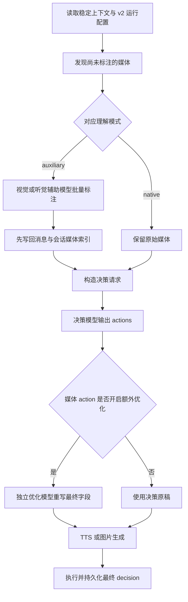

# Prime Figure v2 运行时

本文描述 `prime-figure` 当前的可插拔媒体运行架构，以及模型消息、媒体理解和媒体输出的执行顺序。

## 运行配置

Prime Figure 使用 v2 运行配置，继续支持用户全局配置与会话独立配置：

- `decisionModel`：决策模型。
- `outputs.image`：图片发送开关、内嵌提示词指导等级和图片生成模型。
- `outputs.voice`：语音发送开关、内嵌 transcript 指导等级和 TTS 服务。
- `optimization.image/voice`：可选的额外优化档位与独立模型。
- `understanding.visual/audio`：决策模型原生理解或独立辅助模型理解。
- `context`、`typingCharsPerMinute`、`messageCoalesceMs`：上下文与消息节奏。

各模型拥有独立 endpoint、model 和 API Key。密钥只写入服务端，配置读取只返回是否已配置及脱敏后缀。

新配置默认允许 figure 发送图片和语音，内嵌指导均为 `medium`，额外优化关闭，视觉和听觉均为 `native`。项目不兼容旧 v1 Prime Figure 配置，开发数据库需在升级后重建。

## 一轮决策的执行顺序

辅助视觉和听觉标注可以并行。辅助标注失败会终止本轮，且不会推进 `lastHandledEndUserSeq`；运行时不会擅自把媒体回退给决策模型原生理解。

## 决策模型消息契约

首次决策请求始终只有以下开头：

1. 第一条、唯一一条基础 `system` 消息。
2. 一个 `user` content-parts 数组。

API 的 `user` 表示整个运行数据包；数组中每条时间线 JSON 的 `sender: end_user` 才表示真实聊天用户，`sender: figure` 表示角色自己。

`user` 数据包包含：

- 按时间排序的文本、图片、视频、语音、贴纸和转账记录。
- 当前时间、星期、角色当前处境、行程、完整日程、情绪、关系、变量和可见记忆。
- `availableReferenceImages`。
- 最终的 `hints` 数组。

所有 hints 都只存在于这个 `user` 数据包中。前端输入 `/hint ...` 时仍调用独立调试端点，不写入普通 end-user 消息；服务端把调试指令加入本轮 `hints`，不会再追加第二条 system 消息。

如果调用 `search_recall`，第二次请求只在原始 system/user 后追加 assistant 和 tool 消息，system 仍保持最前且只有一条。

## Prompt 与响应 Schema

System prompt 由独立 composer 按配置组合核心决策、能力、图片、语音、状态、记忆、输出和稳定角色资料模块。可由运行时更新的 `currentSituation`、`itinerary`、`schedule` 只放在末尾 user 数据包的 `figureNow` 中，避免动态状态破坏 system 前缀缓存。

- 关闭图片发送时，不拼入图片规则，显式声明暂不支持 image action，响应 schema 也不包含 image action。
- 关闭语音发送时，不拼入语音规则，显式声明暂不支持 voice action，响应 schema 也不包含 voice action。
- 能力开关是执行硬边界；即使 `/hint` 要求关闭的能力，也不会执行对应 action。
- 如果模型仍误输出已关闭的 image/voice action，能力感知的解析和流式运行时会静默忽略该 action，不创建消息、不调用媒体服务，也不使整轮失败。其余合法 action、状态和记忆更新继续执行；启用能力的畸形输出及未知 action 仍按契约失败。
- 图片和语音内嵌指导分别支持 `basic`、`medium`、`advanced`。

原生媒体理解时，尚未标注的原始媒体进入决策 user 消息，hints 和严格响应 schema 要求返回 `mediaAnnotations`。辅助理解时，决策模型只看到已持久化的文本描述或 transcript，不再看到原始媒体，也不再收到该媒体的标注规则或输出字段。两种模式可以按视觉和听觉混合使用。

## 额外优化与媒体生成

额外图片和语音优化分别支持 `advanced` 与 `top`，每个媒体 action 独立调用对应模型。优化器使用严格单字段 JSON 输出；成功后的字段会替换 decision 原稿，并成为消息展示、持久化、后续上下文和下游媒体服务的统一真值。

优化失败会写入动作日志并回退到决策原稿：

- 图片等待完整的最终 `generationPrompt` 后才调用图片生成服务。
- 非流式语音等待完整的最终 `transcript` 后一次性调用 TTS。
- 流式语音把优化模型的 transcript 字段增量直接写入 TTS WebSocket。
- 流式优化期间先缓存用户可见 transcript 和音频；优化成功后提交，失败则丢弃缓存并用决策原稿重新合成，避免用户看到或听到两份内容。

图片或 TTS 服务本身失败时沿用消息媒体意图错误元数据和实时失败事件；最终文本、图片描述或 transcript 仍可作为对话记录存在。

## 主要模块

- `prime-prompt-composer.ts`：决策、辅助理解与额外优化的 system prompts。
- `prime-media-annotation.service.ts`：视觉/听觉辅助理解与严格标注 schema。
- `prime-content-optimizer.ts`：图片/语音额外优化和 transcript 流解析。
- `prime-figure-runtime.service.ts`：上下文、工具调用和总编排。
- `prime-decision-stream-session.ts`：消息顺序、TTS、图片生成和实时交付。

角色级 `voiceRequestStreaming` 保留，只决定 TTS 使用 WebSocket 流式协议还是 HTTP 完整请求。
