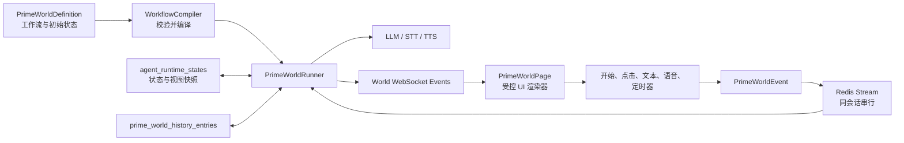
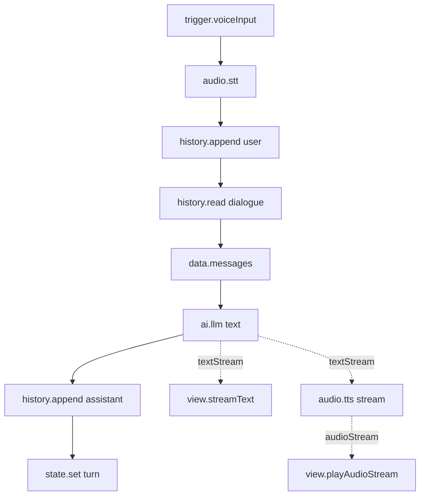
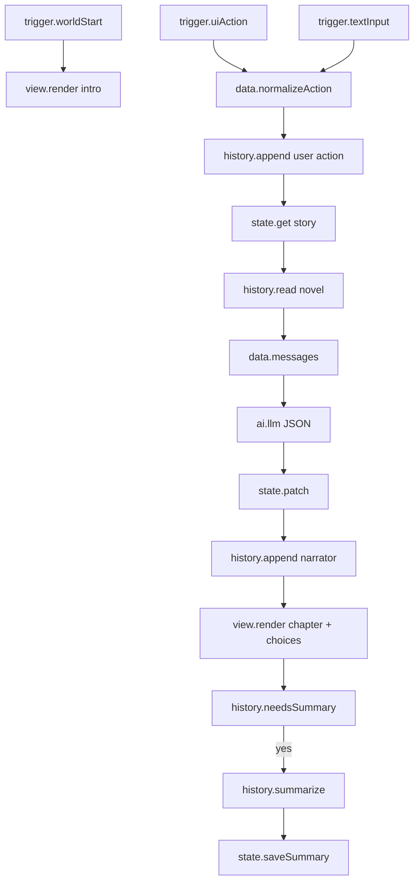

# 本初世界：用户可编排工作流与独立会话运行时设计

本文定义 `prime-world` 的演进方案。目标不是把本初世界做成另一种聊天角色，而是让用户通过受控工作流编排一个独立的、可持久运行的交互世界。世界属于会话体系，复用会话索引、身份、资源、实时连接和运行配置，但不使用聊天时间线作为交互界面，也不把世界操作伪装成 `messages`。

首版必须完整支持两个基准玩法：

1. 语音聊天小游戏：用户语音经过 STT，携带受控历史调用 LLM，增量显示文本并流式 TTS，下个回合继续携带有限历史。
2. 沉浸式小说：用户输入行动或选择推荐选项，LLM 根据大纲、当前阶段、结构化状态、历史摘要和最近剧情续写，并严格输出三个下一步选项。

完整产品验收仍以这两个基准玩法为目标，但交付拆成三个可独立验收的里程碑，避免把核心状态机、生成式 AI 和实时音频一次性耦合上线：

1. M1 核心世界：无模型状态机、持久化 run、受控视图、JSON 编辑和图谱检查。
2. M2 生成世界：LLM、结构化输出、历史窗口和沉浸式小说。
3. M3 语音世界：STT、流式 TTS、抢话和音频重连。

文中“完整首版”指 M1 至 M3 全部完成；单独的里程碑不得冒充完整首版。

## 0. 当前实现基线（2026-07-22）

当前实现已经形成 M1 至 M3 的首版闭环：

- 正式共享类型和 Zod 定义，受控 `WorldView` 固定为 `stack`、`text`、`image`、`choices`、`progress`、`divider`。
- 运行、历史、摘要、定时事件、trace 和运行资源持久化，幂等 event/run 创建、run 定义快照与 draft state CAS 提交。
- Redis Stream 异步执行、同会话 lease、queued run 补偿、终态查询和取消后的提交拦截。
- 节点白名单、端口类型、控制环、重复 ID、单值数据来源、不可达副作用和图规模校验。
- 状态、常量、模板、pick、object、条件、switch、数学、随机、历史追加和基础 view 节点。
- 独立 `PrimeWorldPage`、view revision 防旧操作、可写 XYFlow/CodeMirror 编辑器和内置无模型选择世界模板。
- 服务端节点注册表、确定性 fork/join 调度、流广播、四种显式流转换节点、完整静态/运行时配额和跨进程取消。
- LLM 文本流与动态 JSON Schema、历史窗口与滚动摘要、批量 STT、流式 TTS/字幕/音频播放和失败回滚。
- 作者安全 trace、资源所有权核验、timer/reset，以及版本化 bundle 导入导出。

语音范围采用批量 STT：录音完成并上传为 ready 资源后才进入工作流，不提供实时 STT partial；LLM 文本与 TTS 音频仍可流式传递、播放和抢话。

设计调整：run 表增加 `definition_json` 快照。只保存 revision 无法保证排队期间作者更新定义后，旧 run 仍按接收事件时的定义执行；在引入独立不可变定义版本表前，按 run 保存有界定义快照是更可靠的过渡方案。

## 1. 目标与边界

### 1.1 产品目标

- 用户可以通过画布创建、连接和配置节点，也可以直接编辑同一份规范 JSON。
- JSON 是唯一执行格式；画布是 JSON 的可视化编辑器，两者不维护两套语义。
- 本初世界显示在现有会话列表中，但打开后进入独立 `PrimeWorldPage`，不进入 `MessagesPage`。
- 每个会话拥有独立世界状态、当前视图、历史、运行记录和定时事件。
- 工作流可以完全不使用 LLM，例如通过状态、条件、随机数、数学和 UI 节点实现选择游戏。
- 作者只能使用平台提供的节点和安全模板，不允许执行任意 JavaScript。
- Web、Tauri 桌面端和 Android 使用相同的工作流定义与服务端执行语义。

### 1.2 首版非目标

- 不提供任意 JavaScript、Python、Wasm 或用户上传服务端插件。
- 不提供任意 HTML、CSS、React 组件或远程脚本渲染。
- 不以 60 FPS 动作游戏、物理模拟或低延迟多人对战为目标。
- 不在首版提供文本 DSL；未来 DSL 只能编译为本文定义的规范 JSON。
- 不引入 n8n、LangGraph、Temporal 作为执行核心。
- 不要求浏览器级自动化验证；以共享 schema、服务端集成测试和客户端组件测试为主。

## 2. 与现有项目的关系

当前仓库已经具备以下基础：

- `AgentType`、数据库 `agents.type` 和 `conversations.type` 已包含 `prime-world`。
- `PrimeWorldDetail` 与 `PrimeWorldPlaceholderHandler` 是待替换的占位实现。
- `agent_runtime_states` 已提供 `state_json`、乐观版本号和 agent/conversation 一对一约束。
- Redis Stream 已承担角色运行队列和同会话串行化。
- `ModelSession`、OpenAI 兼容 provider、OpenRouter、Fish Audio STT/TTS、BillingContext 和 WebSocket 推送可以复用。
- `App` 当前统一把 agent 打开到 `MessagesPage`，需要根据 agent 类型分流。

本初世界复用下列公共能力：

- `agents`：世界身份、展示信息和当前工作流定义。
- `conversations`：用户进入世界的会话索引。
- `agent_runtime_states`：结构化世界状态与当前视图快照。
- `resources`、`agent_resources`：作者配置的图片、音频和其他静态资源。
- Redis、WebSocket、运行配置、平台模型与计费。

本初世界不复用下列聊天领域数据：

- 不使用 `messages` 保存按钮点击、文本框提交、场景切换或章节内容。
- 不使用聊天的 `role/content_type/status` 表达世界事件。
- 不复用 `MessagesPage`、消息气泡、消息增量 hook 或聊天滚动窗口。

## 3. 总体架构



世界整体是事件驱动状态机；一次事件触发的内部工作流是无环控制图：

- 世界可以跨回合长期循环。
- 每次 `world.start`、`ui.action`、`input.text`、`input.voice` 或 `timer.fired` 创建一个 run。
- run 在有限时间内完成、失败或取消，不等待下一次用户输入。
- “等待用户选择”通过渲染按钮并结束当前 run 实现；按钮点击创建下一个 run。
- “等待到未来时间”通过登记定时事件并结束当前 run 实现；到期后创建 `timer.fired` run。
- 首版禁止单个 run 内的控制边成环，从根源上避免无限循环和难以恢复的挂起执行。

## 4. 规范工作流 JSON

### 4.1 顶层定义

```ts
export type JsonPrimitive = string | number | boolean | null;
export type JsonValue = JsonPrimitive | JsonObject | JsonValue[];
export interface JsonObject {
  [key: string]: JsonValue;
}
export type JsonSchema = JsonObject;

export interface PrimeWorldDetail {
  schemaVersion: 1;
  definitionRevision: number;
  workflow: PrimeWorldWorkflow;
  initialState: JsonObject;
  stateSchema?: JsonSchema;
  presentation: PrimeWorldPresentation;
}

export interface PrimeWorldWorkflow {
  version: 1;
  nodes: PrimeWorldNode[];
  edges: PrimeWorldEdge[];
  editor: {
    positions: Record<string, { x: number; y: number }>;
    viewport?: { x: number; y: number; zoom: number };
  };
}

export interface PrimeWorldNode {
  id: string;
  type: string;
  version: number;
  name?: string;
  config: JsonObject;
}

export type PrimeWorldEdge =
  | {
      id: string;
      kind: "control";
      source: { nodeId: string; port: string };
      target: { nodeId: string; port: string };
    }
  | {
      id: string;
      kind: "data";
      source: { nodeId: string; port: string };
      target: { nodeId: string; port: string };
    };

export interface PrimeWorldPresentation {
  theme: "system" | "light" | "dark";
  accentColor?: string;
  startView: WorldView;
}
```

`editor` 只保存布局，编译器忽略它。节点 ID 在一次定义中稳定且唯一；节点改名不改变 ID。`definitionRevision` 每次成功保存加一，客户端不能自行指定回退后的 revision。

### 4.2 端口类型

首版支持以下端口类型：

| 类型           | 含义                     |
| -------------- | ------------------------ |
| `control`      | 执行令牌，不携带业务数据 |
| `text`         | 完整 UTF-8 文本          |
| `number`       | 有限数字                 |
| `boolean`      | 布尔值                   |
| `json`         | 通过 JSON 值校验的数据   |
| `messages`     | LLM 消息数组             |
| `audio`        | 已完成的音频资源引用     |
| `audio-stream` | 有序音频块流             |
| `text-stream`  | 有序文本增量流           |
| `event`        | 当前世界事件             |
| `view`         | 完整 `WorldView`         |
| `state-patch`  | 受限状态补丁             |

数据边两端必须同类型。首版不提供隐式类型转换；转换必须通过显式节点完成。普通节点只有在控制输入到达且必需数据输入可用时执行。

### 4.3 节点注册表

服务端节点注册表是执行权限边界：

```ts
export interface PrimeWorldNodeDefinition<TConfig extends JsonObject> {
  type: string;
  version: number;
  configSchema: JsonSchema;
  inputs: PrimeWorldPortDefinition[];
  outputs: PrimeWorldPortDefinition[];
  execution: "sync" | "async" | "stream-source" | "stream-sink";
  execute(
    context: PrimeWorldNodeContext,
    config: TConfig,
  ): Promise<PrimeWorldNodeResult>;
}
```

客户端通过共享节点目录获取端口、表单 schema、图标和说明；服务端独立注册执行 handler。客户端目录不能授予服务端不存在的节点执行权限。

## 5. 编译与执行语义

### 5.1 保存时编译

工作流保存前必须完成：

1. 使用 Zod 校验静态工作流结构。
2. 使用各节点 `configSchema` 校验节点配置。
3. 验证节点类型和版本已注册。
4. 验证边引用存在的节点和端口。
5. 验证数据端口类型完全一致。
6. 验证必需输入存在且单值输入没有多个来源。
7. 验证每个触发器的控制子图无环。
8. 验证副作用节点可由至少一个触发器到达。
9. 验证所有引用的资源属于作者。
10. 验证图规模与静态配额。

编译结果按 `agentId + definitionRevision` 缓存在服务端内存中。数据库仍只保存规范 JSON，不保存不可移植的闭包或运行对象。

### 5.2 一次 run

每个世界事件最多对应一个 run：

1. API 事务写入 `prime_world_events` 和 `prime_world_runs`。
2. 事务提交后将 run ID 写入 Redis Stream。
3. worker 获取同会话 lease，确保一个 conversation 同时只有一个活动 run。
4. runner 读取当前定义、状态版本、事件和历史游标。
5. runner 复制状态与视图为 run draft。
6. 控制令牌从匹配的触发器开始沿控制边执行。
7. 状态节点只修改 draft；历史追加记录在待提交集合中。
8. 成功时使用 `agent_runtime_states.version` 比较并交换，原子提交状态、视图、历史和 run 状态。
9. 未处理失败时丢弃 draft，保留上一次已提交状态和视图。
10. 释放 lease，并处理同会话的下一个事件。

HTTP 已经返回但 Redis 入队失败时，run 保持 `queued`。后台补偿任务定期扫描超时的 queued run 并重新入队，避免重现聊天链路中“数据已写入但任务永久丢失”的问题。

### 5.3 分支、并行和汇合

- `logic.if` 和 `logic.switch` 只向一个匹配控制输出发送令牌。
- 默认控制流串行执行。
- 首版并行必须使用显式 `flow.fork` 和 `flow.join`。
- `flow.join` 按配置等待 `all` 或 `any`；`any` 到达后取消未开始的兄弟分支，不强制终止已发送的上游计费请求。
- 同一 run 内对同一状态路径的多个写入按实际控制顺序覆盖；编译器对无确定顺序的并行写入报错。

### 5.4 流式端口

流式数据具有 `runId`、`nodeId`、`port` 和从零递增的 `sequence`。执行器在流源启动前注册所有直接流 sink：

- `llm.textStream -> view.streamText` 可以实时显示字幕。
- `llm.textStream -> tts.stream` 可以边生成边合成。
- `tts.audioStream -> view.playAudioStream` 可以边合成边播放。
- 普通下游节点只能读取 `llm.text`、`stt.finalText` 或 `tts.audio` 等完成端口。
- 未完成的 JSON 不进入数据图；`llm.json` 只在完整解析并通过 Ajv 校验后产生。

流开始后遇到失败，服务端发送 `world.run.failed`。客户端删除属于失败 run 的临时流内容并恢复最后一个已提交 `WorldView`。已播放的音频无法撤回，但不得写入成功历史。

### 5.5 取消与打断

- 每个 run 持有 `AbortController`。
- `POST cancel`、切换世界、语音抢话和作者重置会话都可请求取消。
- LLM fetch、STT、TTS WebSocket 和等待中的 stream sink必须监听取消信号。
- 取消后的 run 标记为 `cancelled`，不提交 draft 状态或 assistant 历史。
- 语音抢话不能依赖新 run 中的节点取消旧 run，因为同会话队列会让新 run 等待旧 run。事件接入层收到带 `interruptCurrent: true` 的新输入后，必须立即停止客户端旧音频、触发活动 run 的 `AbortController`，等待旧 run 进入 `cancelled`，再把新事件放入该会话执行队列。

## 6. 持久化设计

### 6.1 世界定义

首版将 `PrimeWorldDetail` 保存到 `agents.definition.detail`。定义保存成功后 `definitionRevision` 加一。一个已经开始的 run 使用启动时捕获的编译结果；下一次 run 使用新 revision。

作者修改工作流时默认重置测试会话。只有新定义的 `stateSchema` 与现有状态完全兼容时，作者才可以选择保留状态。首版不执行自动状态迁移。

### 6.2 运行状态

复用 `agent_runtime_states`，其 `state_json` 固定为：

```ts
export interface PrimeWorldRuntimeState {
  schemaVersion: 1;
  variables: JsonObject;
  view: WorldView;
  summaries: Record<
    string,
    {
      text: string;
      throughSequence: number;
      updatedAt: number;
    }
  >;
  updatedAt: number;
}
```

完整历史不能放入 `state_json`。状态只保存有界结构、滚动摘要和当前视图。

### 6.3 新增表

#### `prime_world_events`

| 字段              | 约束与用途                                                             |
| ----------------- | ---------------------------------------------------------------------- |
| `seq`             | 自增主键，用于稳定排序                                                 |
| `id`              | 全局唯一事件 ID                                                        |
| `owner_user_id`   | 所有者                                                                 |
| `conversation_id` | 所属世界会话                                                           |
| `client_event_id` | 客户端幂等 ID                                                          |
| `type`            | `world.start`、`ui.action`、`input.text`、`input.voice`、`timer.fired` |
| `payload_json`    | 已校验事件负载，只保存资源引用，不内嵌音频                             |
| `created_at`      | 接收时间                                                               |
| `processed_at`    | 成功、失败或取消后的处理时间                                           |

唯一索引为 `(owner_user_id, client_event_id)`；同一客户端事件重复提交必须返回原 event/run。

#### `prime_world_runs`

| 字段                   | 约束与用途                                                                              |
| ---------------------- | --------------------------------------------------------------------------------------- |
| `id`                   | run ID                                                                                  |
| `event_id`             | 唯一，对应一个入站事件                                                                  |
| `owner_user_id`        | 所有者                                                                                  |
| `conversation_id`      | 所属会话                                                                                |
| `definition_revision`  | 本次使用的定义 revision                                                                 |
| `definition_json`      | 接收事件时的有界定义快照，避免排队期间定义更新改变旧 run 语义；未来可迁移到不可变版本表 |
| `status`               | `queued`、`running`、`completed`、`failed`、`cancelled`                                 |
| `state_version_before` | 读取的状态版本                                                                          |
| `state_version_after`  | 成功提交后的版本                                                                        |
| `error_code`           | 稳定错误码                                                                              |
| `error_detail`         | 有长度限制的诊断文本                                                                    |
| `started_at`           | 开始时间                                                                                |
| `finished_at`          | 结束时间                                                                                |
| `created_at`           | 创建时间                                                                                |

#### `prime_world_history_entries`

| 字段              | 约束与用途                                        |
| ----------------- | ------------------------------------------------- |
| `seq`             | 自增主键和历史游标                                |
| `id`              | 全局唯一历史项 ID                                 |
| `owner_user_id`   | 所有者                                            |
| `conversation_id` | 所属会话                                          |
| `run_id`          | 产生该历史项的 run                                |
| `node_id`         | 产生该历史项的节点                                |
| `channel`         | 作者配置的历史频道，例如 `dialogue`、`novel`      |
| `role`            | `system`、`user`、`assistant`、`narrator`、`tool` |
| `content_json`    | 文本或结构化内容                                  |
| `token_estimate`  | 服务端估算 token 数                               |
| `created_at`      | 创建时间                                          |

唯一索引为 `(run_id, node_id, channel, role)`，确保节点重试不会重复追加。

#### `prime_world_scheduled_events`

| 字段              | 约束与用途                                  |
| ----------------- | ------------------------------------------- |
| `id`              | 定时事件 ID                                 |
| `owner_user_id`   | 所有者                                      |
| `conversation_id` | 所属会话                                    |
| `trigger_key`     | 作者定义的定时器名称                        |
| `due_at`          | 到期时间                                    |
| `payload_json`    | 触发负载                                    |
| `status`          | `scheduled`、`leased`、`fired`、`cancelled` |
| `lease_until`     | 多进程领取 lease                            |
| `attempts`        | 投递次数                                    |
| `created_at`      | 创建时间                                    |
| `updated_at`      | 更新时间                                    |

## 7. 历史与上下文

### 7.1 历史频道

每个世界可以定义多个频道，例如：

- `dialogue`：玩家与语音角色的对话。
- `novel`：玩家行动、章节正文和推荐选项。
- `system-events`：作者希望模型看到的结构化事件。

频道只是逻辑隔离，不授予额外权限。`history.read` 必须明确选择频道和允许的 role。

### 7.2 历史读取

`history.read` 配置：

```json
{
  "channel": "dialogue",
  "roles": ["user", "assistant"],
  "maxEntries": 20,
  "maxTokens": 6000,
  "includeSummary": true,
  "order": "oldest-first"
}
```

读取算法：

1. 如果存在频道摘要，先预留摘要 token。
2. 从最新历史向前选择符合 role 的项。
3. 同时满足 `maxEntries` 和 `maxTokens`。
4. 最终按时间正序返回。
5. 单条内容超过剩余 token 时不截断结构化 JSON；文本可以按 Unicode 边界截断并标记 `truncated`。
6. 当前 run 中尚未提交的 `history.append` 项按控制顺序叠加到数据库查询结果，因此本轮刚识别的用户文本可以进入同一 run 的 LLM 上下文。

模型上下文上限还要扣除 system prompt、当前输入、输出预算和 provider 保留空间；`history.read` 的实际 token 上限取节点配置与本次模型剩余额度的较小值。

### 7.3 滚动摘要

`history.needsSummary` 根据“摘要游标之后的历史 token 数”判断是否触发压缩。`history.summarize`：

1. 读取上次摘要、摘要游标之后的较早历史和作者提供的摘要指令。
2. 保留配置数量的最新历史，不把它们折叠进摘要。
3. 调用指定模型生成新摘要。
4. 输出 `{ text, throughSequence }`。
5. 通过 `state.saveSummary` 在 run 成功时提交。

摘要失败不删除历史，也不阻断主玩法；错误边可记录诊断并继续使用旧摘要。

## 8. 首版节点目录

### 8.1 触发器

| 节点                 | 主要输出                    | 行为                       |
| -------------------- | --------------------------- | -------------------------- |
| `trigger.worldStart` | `event`                     | 首次进入或显式重置后触发   |
| `trigger.uiAction`   | `actionId`、`payload`       | 接收受控 UI 操作           |
| `trigger.textInput`  | `text`                      | 接收独立世界文本输入       |
| `trigger.voiceInput` | `audio`                     | 接收录音完成后上传的音频   |
| `trigger.timer`      | `triggerKey`、`payload`     | 接收定时器事件             |

### 8.2 状态与数据

| 节点                   | 行为                                          |
| ---------------------- | --------------------------------------------- |
| `state.get`            | 按安全 JSON Pointer 读取状态                  |
| `state.set`            | 写入单个允许路径                              |
| `state.patch`          | 应用受 schema 和路径 allowlist 限制的补丁     |
| `state.saveSummary`    | 保存频道摘要和游标                            |
| `data.template`        | 使用安全路径插值组装文本                      |
| `data.object`          | 从输入端口构造 JSON 对象                      |
| `data.pick`            | 从已校验 JSON 读取字段                        |
| `data.messages`        | 有序组装 system/user/assistant/tool 消息      |
| `data.normalizeAction` | 将文本提交或 UI action 规范成玩家行动         |
| `data.toText`          | 将 number、boolean 或标量 JSON 显式转换为文本 |

模板只支持字段读取和内置格式化器，不支持函数调用、赋值、循环或动态属性执行。

### 8.3 控制与非 LLM 玩法

| 节点             | 行为                            |
| ---------------- | ------------------------------- |
| `logic.if`       | 结构化比较后选择 true/false     |
| `logic.switch`   | 按等值或枚举分支                |
| `logic.compare`  | 比较 text、number、boolean      |
| `logic.math`     | 加减乘除、取整、最小值、最大值  |
| `logic.random`   | 有界整数、浮点或候选项随机选择  |
| `flow.fork`      | 启动显式并行分支                |
| `flow.join`      | 按 `all` 或 `any` 汇合          |
| `timer.schedule` | 登记未来事件                    |
| `timer.cancel`   | 取消指定 trigger key 的定时事件 |

### 8.4 历史

| 节点                   | 行为                                |
| ---------------------- | ----------------------------------- |
| `history.append`       | 追加文本或 JSON 历史项              |
| `history.read`         | 按频道、role、条数和 token 窗口读取 |
| `history.needsSummary` | 判断是否超过摘要阈值                |
| `history.summarize`    | 生成滚动摘要和游标                  |

### 8.5 AI 与音频

| 节点        | 主要输入和输出                            | 行为                     |
| ----------- | ----------------------------------------- | ------------------------ |
| `ai.llm`    | `messages` -> `textStream/text` 或 `json` | 复用平台或自定义模型配置 |
| `audio.stt` | `audio` -> `finalText`                    | 仅支持完整资源的批量识别 |
| `audio.tts` | `text/textStream` -> `audio/audioStream`  | 支持完整和流式合成       |

`audio.stt` 实际仅接受完整 `audio` 并输出 `finalText`。如果未来节点只产生 `audio-stream`，必须显式使用 `convert.audioFromStream` 收集后再进入 STT。

### 8.6 显式流转换

| 节点                      | 转换                          | 默认与上限                                    |
| ------------------------- | ----------------------------- | --------------------------------------------- |
| `convert.textToStream`    | `text -> text-stream`         | 按 Unicode 字符确定性分块，默认 256 字符      |
| `convert.textFromStream`  | `text-stream -> text`         | 等待流完成，最多 128 KiB                      |
| `convert.audioToStream`   | `audio -> audio-stream`       | 从资源分块读取，默认 64 KiB                   |
| `convert.audioFromStream` | `audio-stream -> audio`       | 最多 12 MiB；成功固化，失败或取消时清理资源   |

`ai.llm` 的 JSON 模式使用作者配置的 JSON Schema 子集。允许 `object`、`array`、`string`、`number`、`integer`、`boolean`、`enum`、`required`、数组数量和字符串长度限制；禁止远程 `$ref`、递归 schema 和未声明属性。Ajv 校验失败走 `invalid` 错误端口，不得把未校验数据传给状态或 UI。

### 8.7 显示与播放

| 节点                   | 行为                                   |
| ---------------------- | -------------------------------------- |
| `view.render`          | 用完整 `WorldView` 替换 run draft view |
| `view.patch`           | 修改已存在且类型匹配的 element         |
| `view.streamText`      | 将文本增量写入临时 text element        |
| `view.showChoices`     | 渲染受控选项并绑定 action ID           |
| `view.setBusy`         | 设置输入禁用与运行提示                 |
| `view.playAudio`       | 播放完整音频资源                       |
| `view.playAudioStream` | 顺序播放音频块                         |
| `view.stopAudio`       | 停止当前世界音频                       |
| `view.showError`       | 展示作者配置的可恢复错误状态           |

## 9. 独立世界 UI 协议

### 9.1 WorldView

```ts
export interface WorldView {
  revision: number;
  title?: string;
  background?: WorldBackground;
  root: WorldViewElement;
  input?: WorldInputSpec;
  audio?: {
    autoPlay: boolean;
    allowInterrupt: boolean;
  };
}

export type WorldViewElement =
  | WorldStackElement
  | WorldTextElement
  | WorldImageElement
  | WorldChoicesElement
  | WorldProgressElement
  | WorldDividerElement;
```

首版渲染元素固定为 `stack`、`text`、`image`、`choices`、`progress` 和 `divider`。容器最大深度 12，元素总数最大 200。文本不解释 HTML；`image` 与背景只保存已授权的 `resourceId`，客户端通过现有资源访问接口将其解析为可访问 URL。

`choices` 中每个选项包含稳定 `id`、显示 `label`、可选 `description` 和提交给服务端的 JSON payload。客户端不能将作者未声明的 action ID 发送给服务端；服务端仍会根据当前 view revision 复核 action 是否有效，防止重复点击旧选项。

### 9.2 客户端页面分流

打开 agent 时按类型选择页面：

```text
slice-figure -> MessagesPage
prime-figure -> MessagesPage
prime-world  -> PrimeWorldPage
```

`PrimeWorldPage` 拥有独立 service、query key、实时订阅、输入控制器、音频控制器和错误边界。桌面端仍可显示会话侧栏；移动端进入全屏世界。离开页面时停止本地播放并取消订阅，但默认不取消服务端 run，除非作者将该交互配置为必须前台运行。

## 10. HTTP 与 WebSocket

### 10.1 作者接口

| 方法    | 路径                                 | 用途                                         |
| ------- | ------------------------------------ | -------------------------------------------- |
| `GET`   | `/prime-world/catalog`               | 获取服务端实际注册的节点目录                 |
| `POST`  | `/prime-world/validate`              | 聚合校验未保存工作流，返回全部可定位问题     |
| `POST`  | `/prime-world/import`                | 导入并完整重验版本化世界 bundle              |
| `POST`  | `/agents`                            | 创建世界与初始会话                           |
| `PATCH` | `/agents/:agentId/prime-world`       | 保存定义并增加 revision，可选择保留运行状态  |
| `POST`  | `/agents/:agentId/prime-world/reset` | 重置作者测试会话                             |

校验错误包含 `code`、`message`、`nodeId`、可选 `port` 和 JSON Pointer，画布与 JSON 编辑器可以定位同一错误。

### 10.2 运行接口

| 方法   | 路径                                             | 用途                                         |
| ------ | ------------------------------------------------ | -------------------------------------------- |
| `GET`  | `/prime-world/:conversationId`                   | 获取定义摘要、状态版本、当前 view 和活动 run |
| `GET`  | `/prime-world/:conversationId/export`            | 导出不含运行状态、历史和密钥的版本化 bundle  |
| `POST` | `/prime-world/:conversationId/events`            | 提交文本、语音或 UI 事件                     |
| `GET`  | `/prime-world/:conversationId/runs/:runId`       | 获取 run 状态                                |
| `GET`  | `/prime-world/:conversationId/runs/:runId/trace` | 原创世界作者获取安全 trace                   |
| `POST` | `/prime-world/:conversationId/runs/:runId/cancel`| 取消活动 run                                 |
| `POST` | `/prime-world/:conversationId/reset`             | 清除状态、历史、定时器并重新触发 start       |

事件请求：

```ts
export interface SubmitPrimeWorldEventRequest {
  clientEventId: string;
  type: "ui.action" | "input.text" | "input.voice";
  expectedViewRevision?: number;
  interruptCurrent?: boolean;
  payload: JsonObject;
}
```

`input.voice` 的 payload 引用已完成上传且状态为 ready 的 resource ID。客户端沿用 MP3 recorder，Prime World 最长录制 120 秒；录音结束后执行两阶段上传，再创建正式 `input.voice` world event。工作流中的 `audio.stt` 读取完整资源并调用一次批量 STT，不存在 capture session、流式 STT 或 partial transcript。

### 10.3 服务端实时事件

在现有 App WebSocket 协议中增加：

- `world.run.started`
- `world.run.completed`
- `world.run.failed`
- `world.run.cancelled`
- `world.view.committed`
- `world.view.text_delta`
- `world.audio.started`
- `world.audio.chunk` 二进制帧
- `world.audio.completed`
- `world.audio.failed`

run、view 和音频事件包含 `conversationId` 与 `runId`，增量事件包含 `sequence`。`world.view.committed` 携带完整 view 和新状态版本，是断线恢复的稳定边界；文本和音频增量不进入通用 sync change log。协议不定义 `world.stt.partial`。

## 11. 完整基准玩法一：语音聊天小游戏

### 11.1 玩法定义

玩家按住或点击录音，提交一句话。录音完成并批量识别后，系统读取最近对话与摘要，调用 LLM 生成角色回答，同时增量显示回答字幕并流式播放语音。完成后保存用户与 assistant 的完整历史。玩家在播放期间再次说话会打断旧语音和旧 run。

### 11.2 状态

```json
{
  "variables": {
    "character": {
      "name": "米娅",
      "persona": "一名守护废弃空间站的导航员",
      "relationship": 0,
      "discoveredTopics": []
    },
    "game": {
      "turn": 0,
      "status": "active"
    }
  },
  "summaries": {}
}
```

### 11.3 节点图



关键连接语义：

- `audio.stt.finalText` 连接到用户历史与 LLM；STT 不产生 partial。
- 语音事件配置 `interruptCurrent: true`；旧 run 的取消发生在事件接入层，不占用新图中的节点。
- 用户历史在读取窗口前提交到 run draft，因此本轮用户文本包含在 LLM messages 中。
- `ai.llm.textStream` 同时连接字幕和 TTS；两个 sink 在 LLM 开始前注册。
- `history.append assistant` 使用 `ai.llm.text` 完成端口，绝不保存半截回答。
- run 成功后一次性提交用户历史、assistant 历史、turn 和最终 view。

### 11.4 Prompt 消息

`data.messages` 按以下顺序构造：

1. system：游戏规则、角色 persona、允许修改的状态字段和安全边界。
2. system：`dialogue` 滚动摘要，缺失时不添加。
3. history：最近最多 20 条 user/assistant 历史，总计最多 6000 tokens。
4. system：当前回合、关系值和已发现主题。

LLM 节点使用文本模式，最大输出由运行配置限制。回答失败走 `view.showError`，允许玩家重试同一录音；幂等 client event 不会重复计费，显式重试创建新的 client event。

### 11.5 历史压缩

每次成功回合后执行 `history.needsSummary`。当摘要游标之后超过 8000 tokens 时，摘要较早历史，保留最近 8 条原文。摘要必须包含人物关系变化、承诺、已揭示事实、尚未完成目标和玩家偏好，不能虚构未发生事件。

### 11.6 验收条件

- 完整录音可以通过非流式 STT 进入 LLM。
- 每份 ready 音频只产生一次批量 STT 和一次 LLM 调用。
- LLM 首个文本增量到达后可以更新字幕，并在 TTS 产生音频后开始播放。
- 下个回合的 prompt 包含配置窗口内的历史和滚动摘要。
- LLM、TTS 或连接失败不会保存不完整 assistant 历史。
- 语音抢话会停止旧音频、取消旧 run，并处理新录音。
- 页面重连后恢复最后提交的字幕、状态和可用输入，不重放旧音频块。

## 12. 完整基准玩法二：沉浸式小说

### 12.1 玩法定义

玩家可以输入自由行动，也可以点击模型上一轮推荐的三个选项。每一轮根据固定世界观、小说大纲、当前阶段、结构化变量、滚动摘要与最近章节生成一段新剧情，输出严格三个选项，并通过受限补丁推进阶段和变量。

### 12.2 固定定义与运行状态

作者定义保存：

```json
{
  "story": {
    "title": "雾港来信",
    "worldRules": [
      "雾港每天午夜会遗失一段公共记忆",
      "玩家不能通过普通方式离开港区"
    ],
    "stages": [
      {
        "id": "arrival",
        "goal": "抵达雾港并发现第一封信",
        "allowedNextStages": ["investigation"]
      },
      {
        "id": "investigation",
        "goal": "调查记忆消失与灯塔的关系",
        "allowedNextStages": ["lighthouse", "betrayal"]
      },
      {
        "id": "lighthouse",
        "goal": "进入灯塔并决定是否恢复全城记忆",
        "allowedNextStages": ["ending_restore", "ending_release"]
      },
      {
        "id": "betrayal",
        "goal": "处理同伴背叛并重新取得灯塔钥匙",
        "allowedNextStages": ["lighthouse"]
      },
      {
        "id": "ending_restore",
        "goal": "恢复记忆的结局",
        "allowedNextStages": []
      },
      {
        "id": "ending_release",
        "goal": "放弃旧记忆的结局",
        "allowedNextStages": []
      }
    ],
    "characters": {
      "lin": {
        "name": "林澈",
        "role": "港务记录员",
        "secret": "他保留着所有被城市遗忘的记录"
      }
    }
  }
}
```

运行状态保存：

```json
{
  "variables": {
    "story": {
      "stageId": "arrival",
      "chapterIndex": 0,
      "location": "渡船",
      "flags": {},
      "inventory": [],
      "characterStates": {
        "lin": {
          "trust": 0,
          "present": false
        }
      },
      "status": "active"
    }
  },
  "summaries": {}
}
```

### 12.3 节点图



### 12.4 LLM 输出 Schema

```json
{
  "type": "object",
  "additionalProperties": false,
  "required": ["narrative", "choices", "statePatch"],
  "properties": {
    "narrative": {
      "type": "string",
      "minLength": 100,
      "maxLength": 6000
    },
    "choices": {
      "type": "array",
      "minItems": 3,
      "maxItems": 3,
      "items": {
        "type": "object",
        "additionalProperties": false,
        "required": ["id", "label"],
        "properties": {
          "id": {
            "type": "string",
            "minLength": 1,
            "maxLength": 48,
            "pattern": "^[a-zA-Z0-9_-]+$"
          },
          "label": {
            "type": "string",
            "minLength": 1,
            "maxLength": 80
          },
          "description": {
            "type": "string",
            "maxLength": 200
          }
        }
      }
    },
    "statePatch": {
      "type": "object",
      "additionalProperties": false,
      "required": [
        "chapterIndexDelta",
        "setFlags",
        "removeFlags",
        "inventoryAdd",
        "inventoryRemove",
        "characterChanges"
      ],
      "properties": {
        "nextStageId": {
          "type": "string",
          "maxLength": 64
        },
        "location": {
          "type": "string",
          "maxLength": 120
        },
        "chapterIndexDelta": {
          "type": "integer",
          "minimum": 0,
          "maximum": 1
        },
        "setFlags": {
          "type": "array",
          "maxItems": 20,
          "items": { "type": "string", "maxLength": 64 }
        },
        "removeFlags": {
          "type": "array",
          "maxItems": 20,
          "items": { "type": "string", "maxLength": 64 }
        },
        "inventoryAdd": {
          "type": "array",
          "maxItems": 10,
          "items": { "type": "string", "maxLength": 80 }
        },
        "inventoryRemove": {
          "type": "array",
          "maxItems": 10,
          "items": { "type": "string", "maxLength": 80 }
        },
        "characterChanges": {
          "type": "array",
          "maxItems": 10,
          "items": {
            "type": "object",
            "additionalProperties": false,
            "required": ["characterId", "trustDelta"],
            "properties": {
              "characterId": { "type": "string", "maxLength": 64 },
              "trustDelta": {
                "type": "integer",
                "minimum": -10,
                "maximum": 10
              },
              "present": { "type": "boolean" }
            }
          }
        }
      }
    }
  }
}
```

Ajv 通过后还要执行领域校验：

- 三个 choice ID 必须唯一。
- `nextStageId` 必须存在于大纲，并属于当前阶段的 `allowedNextStages`；缺失表示保持当前阶段。
- `characterId` 必须存在于作者定义。
- flag 和 inventory 去重后才能提交。
- `chapterIndexDelta` 首版只能为 0 或 1，不能倒退章节。
- 已进入 ending 状态后不再接受普通行动，只允许作者配置的重开或回顾 action。

### 12.5 Prompt 上下文

`data.messages` 按以下顺序构造：

1. system：叙事风格、禁止事项、必须遵守输出 Schema。
2. system：完整世界规则、阶段列表与当前阶段目标。
3. system：当前结构化状态，包括地点、flag、inventory 和人物状态。
4. system：`novel` 频道滚动摘要。
5. history：最近 6 个章节相关历史，总计最多 12000 tokens。
6. user：本轮规范化玩家行动。

历史中的 narrator 项保存 `narrative` 和三个 choice；user 项保存自由文本或所选 choice 的 ID、label 和当时 view revision。这样摘要模型可以区分模型建议与玩家真正选择的行动。

### 12.6 视图

每轮提交后的 `WorldView` 包含：

- 当前章节标题与章节序号。
- 本轮 `narrative` 正文。
- 恰好三个 choice 按钮。
- 可选自由行动输入框。
- 当前阶段的非剧透显示名。
- 作者选择公开的 inventory、关系或进度信息。

按钮 payload 固定为 `{ choiceId, label }`。服务端按 `expectedViewRevision` 验证它来自当前视图，防止连续点击旧按钮产生分叉 run。

### 12.7 摘要策略

当摘要游标之后超过 16000 tokens 时生成摘要，保留最近 3 轮玩家行动与正文原文。摘要必须包含：

- 已发生事件的时间顺序。
- 玩家作出的真实选择，不包含未选择的推荐选项。
- 已揭示秘密与仍未知的谜题。
- 关键物品的取得、消耗与当前位置。
- 角色关系变化和仍有效的承诺。
- 当前阶段目标及进入该阶段的原因。

摘要生成失败时继续使用旧摘要和最近历史；不得阻断玩家获得本轮正文。

### 12.8 验收条件

- `world.start` 能显示序章与首组三个选项。
- 自由文本和 choice 点击都能规范化为玩家行动。
- 每轮 LLM 输出必须经过 JSON Schema 与领域校验。
- 每轮成功结果恰好显示三个唯一选项。
- 不允许模型跳到大纲未授权阶段或修改未授权状态字段。
- 下轮 prompt 包含固定大纲、当前阶段、结构化状态、摘要和最近历史。
- 长篇运行超过摘要阈值后仍保留最近原文，并用新摘要代替较早上下文。
- 重连后恢复当前章节、三个选项和输入状态。
- 重复点击同一旧 view 的选项不会产生两个成功 run。

## 13. 安全、资源与配额

### 13.1 安全边界

- 所有模板路径、状态路径和 UI action 均由结构化配置表达。
- LLM JSON 必须先通过 schema 和领域校验，再进入状态节点。
- UI 文本按纯文本渲染；首版不渲染作者或模型产生的 HTML。
- 资源只通过 resource ID 引用，并在保存定义、提交事件和渲染访问时复核 owner。
- 节点不提供任意网络请求；平台 provider 是唯一外部访问入口。
- 错误详情对作者和普通玩家分级，玩家看不到 API key、上游原始响应或 system prompt。

### 13.2 默认配额

| 项目                           | 首版默认上限         |
| ------------------------------ | -------------------- |
| 单工作流节点                   | 200                  |
| 单工作流边                     | 400                  |
| 单 run 节点执行次数            | 500                  |
| 单 run AI/STT/TTS 外部调用总数 | 8                    |
| 单 run 墙钟时间                | 120 秒               |
| 单 run 事件 payload            | 64 KiB，不含资源文件 |
| `state_json`                   | 256 KiB              |
| `WorldView`                    | 128 KiB              |
| 单次 history.read              | 128 项               |
| 单个历史项 content             | 64 KiB               |
| 单次 LLM JSON 输出             | 128 KiB              |

超限产生稳定错误码并进入节点错误端口；没有连接错误端口时 run 失败。

### 13.3 重试

- 网络断开、429 和上游 5xx 在没有开始向客户端交付流时最多自动重试一次。
- 已产生 LLM 文本流或 TTS 音频后不自动重试，避免重复内容和重复播放；批量 STT 没有 partial 交付。
- JSON 校验失败可以由作者显式连接一次 `ai.llm` 修复节点；执行器不隐式无限修复。
- 所有计费调用复用 BillingContext，并在 run/node 诊断中记录不含密钥的用量信息。

## 14. 编辑器设计

客户端新增 `PrimeWorldEditorPage`：

- 画布使用 `@xyflow/react`。
- JSON 编辑使用 CodeMirror 6。
- 左侧是按触发器、数据、逻辑、历史、AI、音频、显示分类的节点目录。
- 中间是画布或 JSON 分段视图。
- 右侧根据节点 `configSchema` 生成配置表单并显示端口说明。
- 底部显示校验问题和测试 run trace。
- 画布与 JSON 共享同一个内存文档；JSON 语法或 schema 无效时暂停画布同步，但保留用户文本和明确错误位置。
- 保存必须由用户明确触发；保存前调用 validate API。
- 桌面和较宽平板支持完整编辑；手机首版支持运行和只读查看定义，不承诺舒适的复杂画布编辑。

测试 run trace 显示节点开始、完成、失败、耗时、输入输出摘要和计费用量；不显示 secret、完整 system prompt 或大段音频二进制。

## 15. 实施阶段

### 阶段一：共享协议与持久化

状态：已完成。

- 将 `PrimeWorldDetail` 替换为正式 schema，并增加创建、更新、事件、状态、视图和 WebSocket 类型。
- 增加工作流 Zod schema、动态 JSON Schema 约束和节点目录类型。
- 增加事件、运行、历史、定时事件、trace 和运行资源六张 prime world 表及 repository。
- 扩展 sync/entity 类型，使 agent 定义更新可以同步；世界增量不进入通用 sync。
- 完成 schema、repository 和幂等事件测试。

完成标准：合法定义可保存，非法图返回可定位错误；事件和 run 原子创建；重复 client event 返回同一 run。

### 阶段二：编译器与核心执行器

状态：已完成，包括 fork/join、timer、显式流转换、完整配额和跨进程取消。

- 实现节点注册表、图编译器、控制调度、数据端口、draft state、原子提交和取消。
- 扩展 Redis run job 支持 `prime-world`，保留同会话串行 lease。
- 实现状态、模板、对象、pick、messages、条件、switch、数学、随机、历史和基础 view 节点。
- 实现 queued run 补偿扫描。

完成标准：不调用外部模型即可制作并运行一个有状态选择游戏；失败 run 不污染状态或历史。

### 阶段三：独立运行界面与编辑器

状态：已完成，包括可写画布、节点配置面板、实时文本/音频订阅和失败回滚。

- 新增 `PrimeWorldPage`、受控 WorldView renderer、世界输入与实时 runtime。
- 修改 App 打开逻辑，让 `prime-world` 不进入 MessagesPage。
- 新增 `PrimeWorldEditorPage`、`@xyflow/react` 画布、CodeMirror JSON、配置面板和校验定位。
- 实现 view revision 防旧操作、断线快照恢复和 run 错误展示。

完成标准：用户只通过画布或 JSON 可创建、运行和调试一个不依赖 LLM 的世界。

### 阶段四：LLM、历史窗口与沉浸式小说

状态：已完成。

- 封装现有 ModelSession 为 `ai.llm` 节点。
- 使用 Ajv 实现动态输出 schema，并实现状态补丁领域校验。
- 实现 history token 窗口、滚动摘要节点和摘要游标。
- 按第 12 节创建内置“雾港来信”示例定义，作为集成 fixture 和手工验收世界。

完成标准：沉浸式小说的全部验收条件通过，连续运行与摘要压缩测试覆盖至少 30 个模拟回合。

### 阶段五：语音链路

状态：已完成；STT 按已确认范围仅提供录音完成后的批量模式。

- 封装现有 Fish Audio 非流式 STT、流式 TTS 和资源存储。
- 复用两阶段资源上传提交完整录音；不增加 streaming STT adapter 或 partial 事件。
- 实现 LLM 文本流到字幕与 TTS 的双 sink、音频二进制帧和客户端播放控制。
- 实现语音抢话、取消、失败回滚和重连恢复。
- 按第 11 节创建内置“空间站导航员”示例定义，作为集成 fixture 和手工验收世界。

完成标准：语音聊天小游戏的全部验收条件通过；批量 STT、LLM 双流、流式 TTS、抢话和失败回滚有测试。

### 阶段六：配额、诊断与发布准备

状态：已完成。

- 落实节点、状态、视图、历史、调用次数和墙钟时间配额。
- 完善作者 run trace、稳定错误码、计费诊断和敏感信息脱敏。
- 增加定义导入导出；导入始终重新校验，不信任来源中的 revision。
- 为未来公开发布保留不可变版本快照接口，但首版不开放自动迁移旧会话状态。

完成标准：两个基准世界可导出、重新导入并创建干净会话，行为与原定义一致。

## 16. 测试计划

### 16.1 共享层单元测试

- 工作流 schema 接受合法节点与边。
- 拒绝未知节点、未知版本、错误端口、类型不匹配、重复 ID 和控制环。
- JSON Schema 子集拒绝远程引用、递归和未声明属性。
- WorldView 拒绝超深树、超量元素、HTML 和无效 action。
- 小说输出拒绝非三个选项、重复 choice ID 和非法状态补丁。

### 16.2 执行器单元测试

- 控制分支只执行匹配路径。
- fork/join 的 all 与 any 行为确定。
- 状态只在成功时提交。
- 并行状态写冲突在编译期被拒绝。
- stream sink 在源启动前注册，序列保持有序。
- 取消会中止 provider 并阻止状态与 assistant 历史提交。
- 外部调用开始流式交付后不自动重试。

### 16.3 服务端集成测试

- event 与 run 原子创建，clientEventId 幂等。
- queued run 入队失败后可由补偿扫描恢复。
- 同一 conversation 的多个事件严格串行。
- 状态 version 比较并交换失败时不会覆盖新状态。
- WebSocket 只向 owner 推送对应世界事件。
- 重连 GET 返回最后 committed view，而不是临时 stream 内容。
- 历史窗口同时遵守条数和 token 上限。
- 摘要游标之前的历史不重复进入后续摘要。
- 平台模型、STT 和 TTS 的计费上下文包含 owner 与 conversation。

### 16.4 客户端组件测试

- 打开 `prime-world` 进入 PrimeWorldPage，其他角色仍进入 MessagesPage。
- WorldView 的所有首版元素正确渲染。
- choice 提交携带当前 view revision，并在 busy 时禁止重复提交。
- 文本 delta 按 sequence 合并，失败 run 删除临时内容。
- 音频 chunk 按 sequence 播放，取消和抢话停止旧音频。
- JSON 编辑错误不会破坏最后一个有效画布文档。
- 节点配置错误可从问题列表定位到画布节点和 JSON Pointer。

### 16.5 两个基准世界验收测试

- 使用固定 provider stub 完整执行语音回合，验证 STT final、历史窗口、LLM 双流、TTS、取消和历史提交。
- 使用固定 provider stub 连续执行小说 30 回合，验证阶段迁移、恰好三个选项、状态补丁、摘要生成和上下文有界。
- 模拟模型返回无效 JSON、第四个选项、非法阶段和未知人物，确认均不能修改状态。
- 模拟断线、重复事件、worker 重启和 Redis 短暂失败，确认最终只有一次成功 run。

运行测试时遵守仓库约定，显式设置 CI 与临时目录：

```powershell
$env:CI = "true"
$env:TMPDIR = "/tmp"
$env:TEMP = "/tmp"
$env:TMP = "/tmp"
pnpm --filter @echoo/server test
pnpm --filter @echoo/client test
pnpm typecheck
```

## 17. 最终验收定义

本初世界首版只有在以下条件全部成立时才算完成：

1. 用户可以通过画布和 JSON 双向编辑同一工作流，并获得节点级校验错误。
2. 本初世界属于会话列表，但拥有独立运行页面、输入、状态、历史和实时事件。
3. 普通世界事件不写入 `messages`。
4. 一次 run 的控制图无环、可取消、可限制资源，并在失败时不提交 draft。
5. 语音聊天小游戏完整支持 STT、历史窗口、LLM 文本流、流式 TTS、历史保存和语音抢话。
6. 沉浸式小说完整支持大纲、阶段控制、结构化状态、自由行动、恰好三个选项、滚动摘要和非法状态更新拦截。
7. 两个基准世界在 Web、Tauri 桌面端和 Android 使用同一服务端执行语义。
8. 测试覆盖幂等、并发、重连、取消、流式顺序、JSON 校验、摘要和计费边界。
