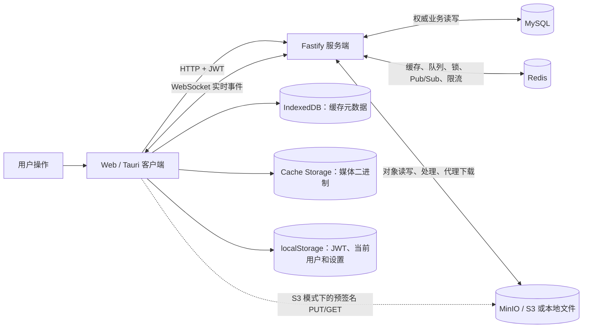
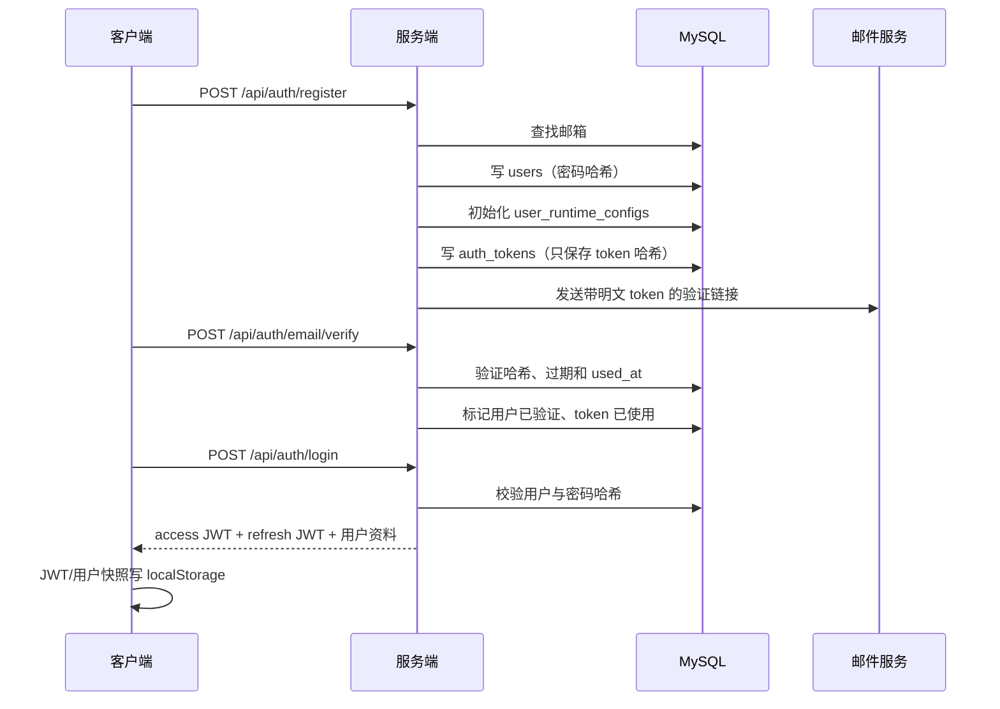
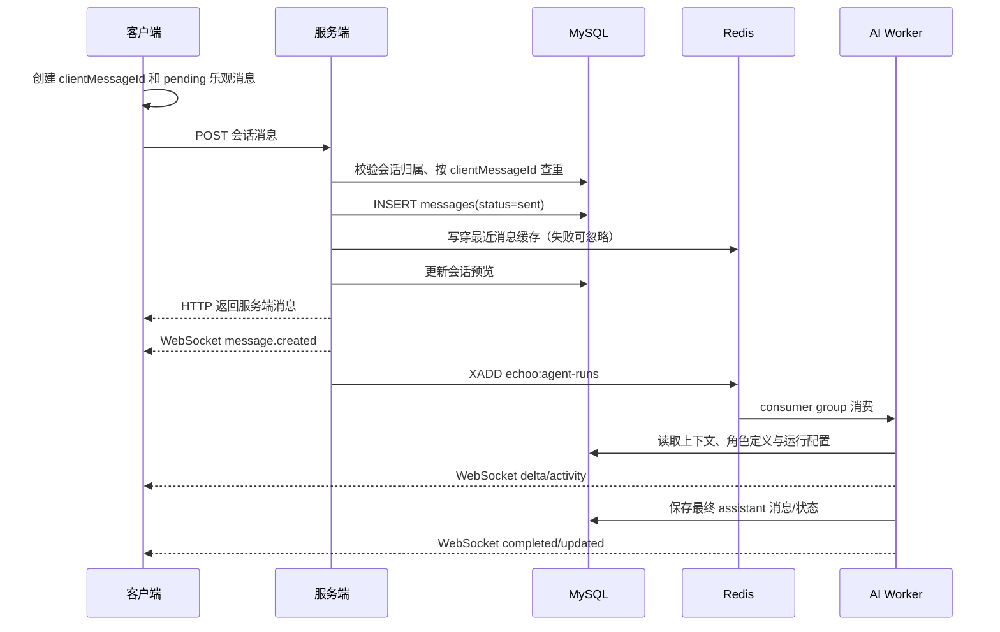

# Echoo 当前存储设计与数据流

> 本文描述的是仓库当前代码的实际行为，而不是目标架构。结论基于 2026-07-15 的代码，并用 CodeGraph 辅助追踪了跨模块调用关系。文中的“IndexedDB”也对应日常口语中的“IndexDB”。

## 1. 一句话结论

Echoo 当前采用“服务端权威数据 + 浏览器轻量缓存”的设计：

- **MySQL 是业务事实来源**：用户、令牌记录、角色、会话、消息、运行状态、资源元数据和资源引用关系都以 MySQL 为准。
- **Redis 不是事实来源**：它承担消息热缓存、异步任务队列、分布式锁、实时事件跨实例广播和限流；Redis 丢数据不应丢失业务记录，但会造成任务不执行、实时通知缺失或缓存回源。
- **MinIO 是 S3 兼容的对象存储**：只保存图片、语音等二进制对象；对象属于谁、是否就绪、被哪条消息或哪个角色引用，仍由 MySQL 决定。
- **IndexedDB 只保存媒体缓存的元数据**：媒体二进制实际放在浏览器 Cache Storage。消息历史没有落到 IndexedDB，也没有真正的离线消息库。
- **客户端 React/React Query 状态是展示窗口，不是持久层**：当前会话最多保留 300 条消息的内存窗口，刷新页面后重新向服务端加载。
- **服务端是所有业务授权和编排入口**：即使开启 MinIO 直传/直下，客户端也必须先经过服务端创建上传票据或换取下载地址。



## 2. 各组件的角色

| 组件                 | 当前保存/承担的内容                                                  | 是否权威                                   | 数据丢失后的结果                                   |
| -------------------- | -------------------------------------------------------------------- | ------------------------------------------ | -------------------------------------------------- |
| 客户端 React 状态    | 当前会话消息窗口、乐观消息、页面状态                                 | 否                                         | 页面刷新后重拉；尚未提交成功的乐观消息会丢失       |
| React Query 内存缓存 | 已访问会话的消息窗口，进程内复用                                     | 否                                         | 刷新后重拉                                         |
| `localStorage`       | access token、refresh token、过期时间、当前用户快照、普通设置        | 否；JWT 是访问凭据                         | 退出登录或需要重新登录；不影响服务端业务数据       |
| IndexedDB            | 媒体缓存的大小、MIME、最后访问时间、ETag                             | 否                                         | 媒体重新下载                                       |
| Cache Storage        | 图片/语音 Blob                                                       | 否                                         | 媒体重新下载                                       |
| 服务端进程内存       | WebSocket 连接、客户端事件订阅、少量调度状态；部分尚未完成的占位实现 | 否                                         | 连接重建；进程内占位数据丢失                       |
| MySQL                | 用户、角色、会话、消息、资源元数据、运行配置和状态                   | **是**                                     | 核心业务数据丢失                                   |
| Redis                | 热消息缓存、Streams 队列、锁、Pub/Sub、限流窗口                      | 否，但异步执行依赖它                       | 缓存可回源；任务、跨实例实时事件和限流会降级或中断 |
| MinIO / S3           | 原始媒体和派生版本二进制                                             | 对二进制内容是权威载体，但业务关系不在这里 | MySQL 中的资源会变成“有记录但打不开”               |
| 本地文件存储         | `RESOURCE_STORAGE_PROVIDER=local` 时替代 MinIO                       | 同上                                       | 同上，且多服务实例不能天然共享                     |

当前 `.env.example` 默认 `RESOURCE_STORAGE_PROVIDER=s3`，配合 `docker-compose.yml` 启动 MinIO 并创建 `echoo-private` bucket。只有显式改回 `local` 时，服务端才会把媒体写入 `.data/resources`。

## 3. 客户端存储

### 3.1 身份和普通设置：localStorage

Web 端登录成功后保存：

- `echoo.auth.access_token`
- `echoo.auth.refresh_token`
- `echoo.auth.expires_at`
- `echoo.setting.auth.currentUser`

`WebStorageRuntime` 还允许以 `echoo.setting.<key>` 保存其他设置。当前用户快照只用于本地体验，启动时仍会携带 access token 调用 `/api/auth/me` 验证；验证失败就清除本地会话。

Tauri 当前继承同一套 Web 存储实现，所以主前端仍使用 WebView 的 `localStorage`。`save_tokens_for_native` Rust 命令目前是空实现，SQLite 也只是占位；因此不要把当前 Tauri 代码理解成“已经有原生安全凭据库和本地消息数据库”。

### 3.2 消息：只在内存中保留窗口

消息列表的事实来源是 MySQL。客户端打开会话时：

1. 先读取 React Query 中同一页面生命周期内的缓存窗口（如果有）。
2. 调用服务端加载最新 50 条消息。
3. 向上/向下翻页时继续使用消息 ID 作为游标。
4. 内存窗口最多 300 条；超出后从一端裁剪。
5. WebSocket 到达的新消息与 HTTP 返回结果按照 `id` 或 `clientMessageId` 合并。

客户端没有把消息、失败发送任务或同步游标持久化到 IndexedDB。因此：

- 在线发送时有乐观 UI，但刷新页面会丢失尚未在服务端成功落库的消息。
- 不能在离线状态下可靠排队，恢复网络后也没有持久化重放队列。
- 重新连上 WebSocket 本身不会补发漏掉的事件；页面通过重新请求最新消息来收敛到 MySQL 状态。

### 3.3 媒体：IndexedDB + Cache Storage

媒体缓存由两部分组成：

- IndexedDB 数据库 `echoo-media-cache`，版本 2，object store 为 `metadata`。
- Cache Storage 缓存 `echoo-media-bodies-v2`，保存真正的 `Response/Blob`。

缓存键为：

```text
<userId>:<resourceId>:<variant>
```

其中 `variant` 是 `original`、`thumb` 或 `display`。这样同一浏览器上的不同用户不会共用授权媒体缓存；退出登录时会清理当前用户的缓存项。

缓存策略：

- 默认预算 128 MiB。
- 能取得浏览器 quota 时取 quota 的 10%，但最高 512 MiB。
- 单个对象超过预算的 25% 时不缓存。
- 超预算后按 `lastAccessedAt` 做近似 LRU 清理，清到预算的 80%。
- 最多并发下载 4 个媒体。
- 缓存读取超过 250 ms、写入超过 1 s 就让位给正常展示；缓存失败不能阻塞媒体交付。

媒体加载的实际路径是：

1. 客户端从业务对象中的 `/api/resources/<id>/file` 提取 `resourceId`。
2. 先查本地媒体缓存。
3. 未命中时携带 access token 请求 `/api/resources/access`。
4. 服务端校验资源所有权与状态，返回短期访问 URL。
5. 客户端下载 Blob、展示为临时 object URL，并尽力写入 Cache Storage 与 IndexedDB。

IndexedDB 在这里不是媒体主体存储，也不保存角色、会话或消息。

## 4. 服务端存储与职责

### 4.1 服务端是控制面

服务端负责：

- 校验 JWT 和资源所有权。
- 保证客户端只能操作自己的用户、角色、会话、消息和媒体。
- 把业务记录写入 MySQL。
- 生成 S3/MinIO 预签名 URL。
- 驱动 Redis 队列、锁和 Pub/Sub。
- 处理图片派生版本、语音校验和 AI 生成内容。
- 把 MySQL 的变化通过 WebSocket 推给当前在线客户端。

它本身不应是消息事实来源，但在 `local` 资源 provider 下，媒体文件会直接落到服务端目录 `.data/resources`，这时服务端磁盘也成为二进制持久层。

### 4.2 MySQL：权威业务数据库

服务启动时必须成功连接 MySQL，并执行基础 schema 和迁移；MySQL 不可用会直接阻止服务启动。

主要表如下：

| 表                             | 作用                                                    | 关键关系                                 |
| ------------------------------ | ------------------------------------------------------- | ---------------------------------------- |
| `users`                        | 用户、邮箱、密码哈希、邮箱验证时间                      | 邮箱唯一                                 |
| `auth_tokens`                  | 邮箱验证和密码重置 token 的 SHA-256 哈希                | 用户删除时级联删除                       |
| `user_runtime_configs`         | 用户级 AI/运行配置，包括服务端使用的 API key            | 每用户一条                               |
| `agents`                       | 角色定义 JSON、运行状态 JSON、`next_run_at`             | 属于用户                                 |
| `conversations`                | 会话摘要、未读数、运行状态、关联角色                    | 一个角色唯一关联一个会话                 |
| `conversation_runtime_configs` | 会话级运行配置覆盖                                      | 会话删除时级联删除                       |
| `messages`                     | 全局递增 `seq`、正文 JSON、运行元数据、状态、全文检索列 | `client_message_id` 对用户唯一，用于幂等 |
| `resources`                    | 对象元数据、provider、storage key、状态、hash 和时长    | 不保存二进制本体                         |
| `resource_variants`            | original/thumb/display 的对象 key 与元数据              | 资源删除时级联删除                       |
| `message_resources`            | 消息引用哪些资源                                        | 防止仍被消息引用的资源被删除             |
| `agent_resources`              | 角色头像、封面、参考图、表情引用                        | 防止仍被角色引用的资源被删除             |

`agents.definition` 保存相对稳定的角色定义；`agents.runtime_state` 保存本初角色的变量、记忆、情绪、关系、沉默与唤醒计划。`conversations.runtime_state` 保存会话级运行进度，例如本初角色已处理到哪条用户消息。消息的 `run_metadata` 保存模型、媒体语义、转账状态、记忆摘要等扩展数据。

### 4.3 Redis：缓存、协调与异步执行

Redis 当前有五类用途：

1. **消息热缓存**
   - `echoo:messages:recent:<user>:<conversation>`：按消息 sequence 排序的最近消息。
   - `echoo:messages:recent-meta:...`：缓存覆盖范围。
   - `echoo:messages:live:...`：流式回复尚未完成时的最新文本。
   - 默认每会话最多 200 条，TTL 6 小时。
   - 读取失败或未覆盖所需范围时回源 MySQL；写缓存失败只记录 warning。

2. **AI 运行队列**
   - Redis Stream `echoo:agent-runs`，consumer group `echoo-server`。
   - 默认并发 8。
   - 每个会话用 `echoo:run-lock:<conversation>` 串行化运行。
   - 本初角色运行中又收到消息时使用 `echoo:run-dirty:<conversation>` 合并触发。
   - 失败最多重试 3 次，最终写入 `echoo:agent-runs:failed`。

3. **资源处理和清理队列**
   - `echoo:resource-processing`：校验上传、计算 hash/时长、生成 thumb/display。
   - `echoo:resource-cleanup`：每小时扫描 24 小时前的孤儿资源并删除对象。
   - 两者也使用 Redis Stream、consumer group 和资源锁。

4. **实时事件跨实例广播**
   - 当前实例先直接向自己的 WebSocket 连接发送。
   - 再通过 Pub/Sub channel `echoo:realtime` 通知其他服务实例。
   - Redis 不可用时，同实例实时推送仍可工作，但跨实例 fan-out 丢失。

5. **媒体 API 限流**
   - 用 sorted set 做滑动窗口。
   - Redis 异常时当前实现选择 fail-open，即放行请求。

### 4.4 MinIO / S3：私有二进制对象存储

对象 key 当前按下面的结构组织：

```text
<ownerUserId>/<resourceId>/original.<ext>
<ownerUserId>/<resourceId>/thumb.webp
<ownerUserId>/<resourceId>/display.webp
```

MySQL 只保存 key、provider、大小、hash、ETag 等元数据。业务对象中暴露的是稳定的 Echoo 路径：

```text
/api/resources/<resourceId>/file
```

客户端不应长期保存 MinIO 的临时 URL；真正的资源身份是 `resourceId`。

当前各类数据面是否经过 Echoo 服务端如下：

| 操作                          | local provider                     | MinIO/S3 provider                            |
| ----------------------------- | ---------------------------------- | -------------------------------------------- |
| 用户图片/语音上传             | 客户端 → Echoo 服务端 → 本地文件   | 客户端 → 预签名 URL → MinIO/S3，二进制直传   |
| 角色头像/封面/参考图/表情上传 | base64 → Echoo 服务端 → 本地文件   | base64 → Echoo 服务端 → MinIO/S3             |
| AI 生成图片/语音              | provider → Echoo 服务端 → 本地文件 | provider → Echoo 服务端 → MinIO/S3           |
| 上传校验和派生版本            | Echoo 服务端读取并处理             | Echoo 服务端从 MinIO/S3 整体读取、处理后写回 |
| 默认媒体下载                  | Echoo 服务端代理                   | Echoo 服务端代理 MinIO/S3 stream             |
| 开启 S3 直下                  | 不支持预签名直下                   | 先经 Echoo 鉴权，再由客户端直接 GET MinIO/S3 |

## 5. 主要场景的数据流

### 5.1 注册、邮箱验证和登录



特殊情况：

- 已验证邮箱再次注册返回 409。
- 未验证邮箱再次注册不会新建用户，会保留已有配置并创建新的验证 token。
- 忘记密码同样只在 MySQL 保存 token hash；明文 token 只出现在链接/开发响应中。
- JWT 是服务端签名的无状态 token，不在 Redis 中维护登录 session。

### 5.2 创建角色

客户端先把头像、封面、参考图和表情压缩为 JPEG，再以内嵌 base64 的 JSON 一起提交。它们当前没有走通用的预签名上传流程。

服务端流程：

1. 校验角色输入。
2. 对每张图片：服务端解码 base64，校验 JPEG，写入本地文件或 MinIO/S3；在 MySQL 写 `resources` 与 `resource_variants`，并同步生成 thumb/display。
3. 开启一个 MySQL 事务：
   - 写 `agents`；
   - 写一对一 `conversations`；
   - 切片角色配置了 `openingLine` 时，再写一条已送达的 assistant 消息。
4. 事务提交后写 `agent_resources` 引用关系。
5. 返回角色，客户端只更新 React 状态并打开新会话。

这里的边界是：角色、会话和开场白是同一个 MySQL 事务；图片对象和资源元数据在事务之前创建，资源引用在事务之后创建。任一步失败时服务端会尽力删除新资源，但这是补偿逻辑，不是跨 MySQL/MinIO 的原子事务。

### 5.3 发送文字消息



`clientMessageId` 是客户端重试的幂等键，MySQL 还通过 `(owner_user_id, client_message_id)` 唯一索引兜底。

切片角色与本初角色的差异：

- **切片角色**：服务端先在 MySQL 创建一条空的 `pending` assistant 占位消息，再把占位消息 ID 放入 Redis 队列。worker 流式更新 Redis live cache，最终把同一条消息更新为 `delivered` 或 `failed`。
- **本初角色**：用户消息先落库，worker 再根据本初角色状态和未处理消息做决策，可能产生文字、图片、语音、表情、转账、沉默或唤醒计划，并更新角色/会话运行状态。

客户端同时收到 HTTP 返回和 WebSocket 事件不会产生重复消息，因为合并逻辑使用消息 `id`/`clientMessageId` 去重。

### 5.4 发送图片或语音

用户媒体采用独立上传流程：

1. 客户端准备图片 JPEG、语音 MP3 或原始视频 Blob。
2. `POST /api/resources/uploads`：服务端鉴权、限流，在 MySQL 创建 `pending` resource，并返回 PUT ticket。
3. 上传：
   - local provider：PUT 到 Echoo 服务端 `/api/resources/<id>/content`；
   - s3 provider：PUT 到服务端生成的 MinIO/S3 预签名 URL，二进制不经过 Echoo 服务端。
4. `POST /api/resources/<id>/complete`：服务端 HEAD 对象并把状态改为 `processing`。
5. Redis 资源 worker 读取原对象、校验内容、生成派生版本，更新 MySQL 为 `ready`。如果 Redis enqueue 失败，complete 接口会在当前请求中直接处理。
6. 客户端每 250 ms 轮询资源状态，最长约 30 秒。
7. 资源 ready 后，客户端再提交消息，其中只带 `resourceId` 和幂等 `clientMessageId`。
8. 服务端复核 owner、kind 和 ready 状态，写 `messages` 与 `message_resources`，更新预览并触发本初角色运行。

图片、视频和语音消息当前只允许本初角色会话。视频支持 MP4、WebM、MOV/QuickTime 和 MPEG，原文件上限 12 MiB，不转码。角色表情不重新上传，服务端会验证 `stickerId` 确实属于当前角色；删除表情会移除服务端资源，但历史消息保留描述和失效资源标识，客户端可继续使用已有缓存。

### 5.5 AI 生成图片或语音

AI provider/TTS 的结果先回到服务端进程。服务端通过 `saveGeneratedMedia` 写 MinIO/本地文件并创建 MySQL 资源记录，然后把 `resourceId` 放进 assistant 消息。也就是说，生成媒体目前必然经过服务端内存和带宽，不使用客户端直传。

语音流式播放时，音频 chunk 先经 WebSocket 到客户端；完成后客户端会把已收到的音频尽力写入本地媒体缓存，后续仍以服务端资源为权威来源。

### 5.6 读取媒体

默认配置 `RESOURCE_S3_DIRECT_DOWNLOADS=false`：

1. 客户端请求 `/api/resources/access`。
2. 服务端查 MySQL、校验 owner 和 `ready` 状态，签发 10 分钟的 Echoo 媒体 JWT。
3. 客户端请求 `/api/resources/<id>/file?...`。
4. 服务端从 MinIO/S3 读取 stream，再代理给客户端；Range 请求也由服务端转发。

开启 `RESOURCE_S3_DIRECT_DOWNLOADS=true` 后：

1. 客户端仍先请求 Echoo 服务端完成授权。
2. 服务端返回 10 分钟的预签名 GET URL。
3. 客户端直接从 MinIO/S3 下载。

所以“MinIO 必须通过服务端”的准确表述是：**授权控制面始终必须经过服务端；数据面是否经过服务端取决于资源类型和配置。** 当前终端用户媒体在 S3 模式下可以直传；下载默认代理；角色图片和 AI 生成媒体仍由服务端上传。

### 5.7 删除会话/角色与资源清理

角色会话删除时，服务端在 MySQL 事务中删除 `agents`；外键继续级联删除 conversation、messages、运行配置和资源引用表记录。随后尽力清理 Redis 消息缓存，并设置 24 小时的会话取消标记阻止旧任务继续运行。

对象本体不会在同一事务中立即删除。每小时的资源清理 worker 会扫描：

- 创建超过 24 小时；
- 不再被 `message_resources` 或 `agent_resources` 引用；
- 状态适合清理；

然后先把 MySQL 状态改为 `deleting`，删除所有对象版本，最后删除 `resources` 记录。这种延迟删除避免了数据库事务与对象存储无法原子提交的问题，但也意味着删除后对象通常还会保留一段时间。

### 5.8 本初角色的定时唤醒

本初角色的计划、沉默到期和被动唤醒信息保存在 `agents.runtime_state`，最近到期时间冗余在 `agents.next_run_at`。服务端进程定时查询 MySQL，使用 `FOR UPDATE SKIP LOCKED` 领取到期项并写入 lease，然后将任务投递到 Redis。MySQL 保存长期状态，Redis 只承载这一次执行。

### 5.9 外部渠道

README 描述了 Telegram/微信/QQ 与角色会话绑定的目标流程，但当前实现还没有接入正式存储：

- binding repository 只是进程内硬编码数组；
- webhook 只返回 `{ ok: true }`；
- delivery repository 只是进程内数组；
- retry/cleanup worker 是占位实现；
- 这些路由也没有形成完整的“外部消息 → MySQL message → Redis AI run → 外部回送”链路。

因此外部渠道目前不能视为已有可靠数据流，更不能依赖它做持久化或投递保证。

## 6. 一致性与降级边界

| 情形                           | 当前行为                                                    |
| ------------------------------ | ----------------------------------------------------------- |
| MySQL 不可用                   | 服务无法正常启动；核心 API 不可用                           |
| Redis 消息缓存不可用           | 回源 MySQL，业务读取可继续；性能下降                        |
| Redis Pub/Sub 不可用           | 同实例 WebSocket 仍发送；跨实例实时事件丢失                 |
| Redis 限流不可用               | 媒体限流 fail-open                                          |
| Redis AI 队列不可用            | 用户消息可能已落 MySQL，但 AI 任务无法投递                  |
| Redis 资源队列不可用           | complete 接口尝试同步处理当前资源；后台恢复和清理仍受影响   |
| MinIO/S3 不可用                | 普通文字业务可能继续；媒体上传、处理、读取和生成失败        |
| IndexedDB/Cache Storage 不可用 | 媒体仍可走网络，不影响服务端数据                            |
| WebSocket 断线                 | 客户端指数退避重连；漏掉的事件靠后续 HTTP 刷新收敛          |
| 客户端刷新                     | 已落 MySQL 的消息恢复；纯本地 pending/failed 状态不保证恢复 |

整体一致性模型可以概括为：

- MySQL 内部部分关键步骤使用事务，具有强一致性。
- MySQL 与 Redis 之间没有事务，采用“先落 MySQL，再尽力缓存/投递”。
- MySQL 与 MinIO 之间没有事务，采用状态机、引用表、补偿删除和延迟清理。
- 客户端与服务端之间通过 `clientMessageId`、分页重拉和 WebSocket 合并实现最终收敛。

## 7. 当前缺陷与风险

以下按影响排序；其中有些是明确缺陷，有些是现阶段的架构限制。

### 高优先级

1. **消息落库与 AI 入队不是原子操作。** 文字消息先写 MySQL，之后才写 Redis Stream。若入队失败，HTTP 会报错，但消息其实已经存在。客户端用同一 `clientMessageId` 重试时，文字消息分支直接返回已有消息，不会再次入队，可能永久没有 AI 回复。媒体消息的重复分支反而会重新触发本初角色任务，两者行为不一致。应使用 transactional outbox，或至少让幂等重试检查/补投任务。

2. **Redis Stream 没有回收其他 consumer 的 pending entry。** worker 使用 `XREADGROUP ... >` 只读新消息，没有 `XAUTOCLAIM`/`XPENDING` 恢复崩溃消费者已经领取但未 ACK 的任务。进程在领取后崩溃会使任务长期卡住。

3. **资源处理队列遇到已有锁时直接 ACK。** 如果另一 worker 的锁最终超时但没有成功完成处理，这个任务已被 ACK；资源会停在 `processing`，通常要等服务重启时 `recoverFromDatabase` 才会重新入队。

4. **Web/Tauri token 存储安全性不足且刷新链路未闭环。** Web JWT 和 refresh token 都在 `localStorage`，容易受 XSS 影响；Tauri 的原生 token 保存命令当前是 no-op。服务端也没有 refresh endpoint，access/refresh token 当前都是 30 天，refresh token 实际没有发挥作用。

5. **WebSocket ACK 没有持久语义。** 客户端会 ACK created/completed，但 `AckService` 只返回内存对象，不更新消息状态或投递记录；`delivery` 和 retry job 也还是占位。因此 `sent/delivered` 不能代表完整的端到端投递保证。

### 中优先级

6. **角色图片上传仍穿过业务 API。** 头像、封面、参考图和表情被压成 base64 放进最大 96 MiB 的角色 JSON，请求体会膨胀约三分之一，服务端还要一次性解码、处理并上传。应统一改成资源预上传 + `resourceId` 引用。

7. **下载默认经过服务端，形成双跳和带宽瓶颈。** 默认的 access 请求之后还要由 Echoo 服务端代理 MinIO stream。开启直下可降低服务端带宽，但要求 MinIO endpoint 对浏览器可达、使用 HTTPS、CORS 正确，并避免向客户端返回 Docker 内网域名。

8. **媒体处理仍会整对象进入服务端内存。** 即使终端用户直传 MinIO，worker 随后仍用 `get()` 把完整对象读成 Buffer，再做图片、MP3 或视频签名校验。当前图片 5 MiB、语音/视频 12 MiB 上限尚可，但扩展到更大视频或文件前需要流式处理或独立媒体 worker。

9. **资源与业务引用不是同一事务。** 创建角色时先创建对象和资源记录，再写角色事务，最后写 `agent_resources`；创建消息时 messages、`message_resources` 和 Redis 缓存也分步执行。尤其是角色事务已经提交、但 `replaceAgentReferences` 失败时，外层补偿会删除新资源，却不会回滚已经提交的角色，可能留下指向失效资源的角色。对象删除本身也多处使用 best-effort/`Promise.allSettled`：对象删除失败后数据库记录仍可能被移除，形成无法再由引用扫描发现的 MinIO 孤儿对象。这里需要事务 outbox/资源操作日志和可重复补偿。

10. **注册流程不是单个事务。** `users`、运行配置、验证 token 和邮件发送逐步执行。中途失败会留下未验证用户或多个有效 token；代码允许重新注册未验证邮箱来恢复，但状态边界需要明确。

11. **provider 切换不是在线迁移。** 每条资源记录保存 `local` 或 `s3`，而 repository 要求记录 provider 与当前全局配置一致。直接改环境变量会让旧资源报错，必须先设计对象复制和数据库迁移。

12. **当前数据库初始化只适用于开发阶段。** 服务启动时直接执行最终版 `schema.sql`，不保留旧结构的升级迁移；结构发生不兼容变化时需要重置开发数据库。进入需要保留数据的环境前，应先引入带事务边界与失败恢复策略的正式迁移工具。

### 客户端与功能完整性

13. **IndexedDB 不是离线数据库。** 它仅记录媒体缓存元数据，正文在 Cache Storage；消息、角色和待发送队列都没有离线持久化。

14. **缓存校验较弱。** 缓存元数据记录 ETag，但读取时没有向服务端做条件校验；设计依赖对象 URL 不变且内容 immutable。若服务端在同一个 resource/variant key 上覆盖内容，本地可能继续展示旧版本。

15. **实时补偿机制不完整。** WebSocket 重连后没有基于最后 sequence 的显式 catch-up；目前依赖会话页面重新拉最新页。若用户停留在页面、重连但没有触发刷新，仍可能暂时漏显示事件。

16. **外部渠道和原生后台能力仍是脚手架。** binding、delivery、webhook、原生 token 和 SQLite 都未形成可依赖的持久链路。

## 8. 建议的演进顺序

1. 先解决“消息落库但任务未入队”：增加 MySQL outbox 表与可靠投递 worker，并为 Redis pending entries 增加 reclaim。
2. 统一所有媒体为“先上传资源、后引用 resourceId”，角色创建不再携带 base64。
3. 在生产 MinIO 配置中启用可控的预签名直传/直下；保留服务端授权，不让 bucket 公开。
4. 为资源状态机增加可周期恢复的 MySQL 扫描，不只在服务启动时恢复 `processing`。
5. 完成 refresh token 的服务端持久化/轮换/吊销，并让 Tauri 使用原生安全凭据存储。
6. 若确实需要离线体验，再为消息和发送 outbox 设计客户端 IndexedDB schema；不要复用当前媒体 metadata store。
7. 最后补齐外部渠道的 MySQL binding/delivery 表、幂等 webhook inbox、可靠外发队列和 ACK/重试状态机。

## 9. 关键代码索引

- 服务启动与依赖装配：[`apps/server/src/app.ts`](../apps/server/src/app.ts)
- MySQL 开发基线 schema：[`schema.sql`](../apps/server/src/infra/database/schema.sql)
- Redis 消息缓存与运行队列：[`message-cache.ts`](../apps/server/src/infra/redis/message-cache.ts)、[`run-queue.ts`](../apps/server/src/infra/redis/run-queue.ts)
- 注册登录：[`auth.service.ts`](../apps/server/src/modules/auth/auth.service.ts)、[`user.repository.ts`](../apps/server/src/modules/auth/user.repository.ts)
- 角色创建：[`agent.repository.ts`](../apps/server/src/modules/agents/agent.repository.ts)
- 消息写入与编排：[`messaging.service.ts`](../apps/server/src/modules/messaging/messaging.service.ts)、[`message.repository.ts`](../apps/server/src/modules/messaging/message.repository.ts)
- 资源 API、对象存储与状态机：[`resources.controller.ts`](../apps/server/src/modules/resources/resources.controller.ts)、[`resource-storage.ts`](../apps/server/src/modules/resources/resource-storage.ts)、[`resource.repository.ts`](../apps/server/src/modules/resources/resource.repository.ts)
- 客户端媒体缓存：[`mediaCache.ts`](../apps/client/src/services/mediaCache.ts)
- 客户端乐观发送与消息窗口：[`useOutgoingMessages.ts`](../apps/client/src/pages/messages/useOutgoingMessages.ts)、[`useConversationTimeline.ts`](../apps/client/src/pages/messages/useConversationTimeline.ts)
- WebSocket 客户端与服务端：[`WebMessageRuntime.ts`](../apps/client/src/runtimes/web/WebMessageRuntime.ts)、[`realtime-event-bus.ts`](../apps/server/src/modules/realtime/realtime-event-bus.ts)
